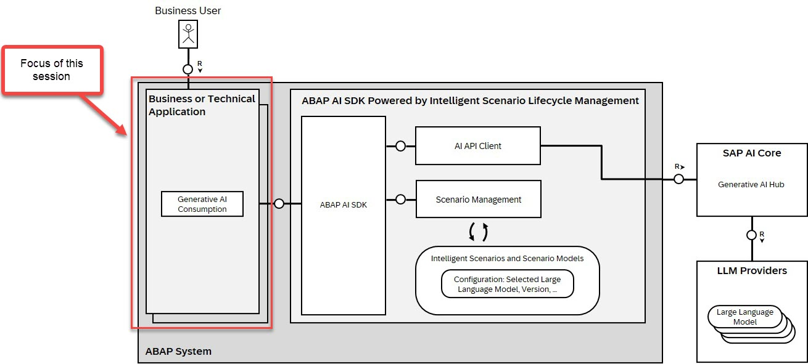

# TM364 - Build smart extensions in  SAP  Cloud  ERP  with  ABAP  Cloud and Business AI

## Bringing AI into enterprise business processes

Enterprises are moving fast with AI. But embedding artificial intelligence into business processes comes with real challenges: complex integration, fragmented lifecycles, scaling beyond proof-of-concepts, and governance and compliance requirements.

Intelligent Scenario Lifecycle Management (ISLM) is built to address these challenges. As an ABAP-native framework, ISLM helps integrate and operate AI within SAP business applications, with unified lifecycle management and enterprise-grade governance. ISLM Supports both SAP-delivered and custom AI use cases.

From Classical Machine Learning and Tabular AI to Generative AI, ISLM brings AI scenarios under one framework. Together with the ABAP AI SDK, powered by ISLM, it enables low-code integration of generative AI into ABAP applications, including access to large language models through the Generative AI Hub in SAP AI Core. The result is lower development effort, more consistent operations, and AI closer to business processes.

More information can be found in the following links: 

- [Developing Your Own AI-Enabled Applications Documentation](https://help.sap.com/docs/abap-ai/generative-ai-in-abap-cloud/developing-your-own-ai-enabled-applications) 
- [New blog post about ISLM availability matrix](https://community.sap.com/t5/enterprise-resource-planning-blog-posts-by-sap/intelligent-scenario-lifecycle-management-islm-availability-matrix-across/ba-p/14499712)
- [Devtoberfest - ABAP AI SDK powered by ISLM](https://www.youtube.com/live/y36Ans6hSyM)
- [Devtoberfest - Bring AI into Your ABAP Applications with ISLM](https://www.youtube.com/live/MRZHKt5lywA)
- [ISLM overview slides](https://d.dam.sap.com/a/Lk7iU2c/ISLM_Devtoberfest_2026.pdf?rc=10&inline=true&doi=SAP1355561)

## Session scenario and focus 

The focus of this session is to show how LLMs (deployed on SAP AI Core) can be leveraged from within your ABAP Code using the ABAP AI SDK and thereby making your RAP business object "smarter".

The scenario of this session is the development of _Trip App_ using the ABAP RESTful Application Programming Model (RAP) where a user can create a trip trip details and add expenses. The ABAP developer can leverage AI by using preconfigured ISLM scenarios so that the focus is on the development of the business logic in ABAP leveraging the ABAP AI SDK. 

The first integration shows the use of the _Orchestration Service_ in SAP AI Core which enables advanced Generative AI capabilities such as document grounding, content filtering, and data masking. The end user can create a trip and add trip details in form of a text such as an email. Trip details such as start date, a summary, the category of the trip are being extracted from the text by calling a large language model (LLM) via ISLM. The following modules offered by the orchestration service are supported by ISLM and will be used in this hands-on: 

1. **Data Masking** – Protects sensitive information by masking or removing confidential data. 
2. **Input Filtering** – Validates and sanitizes incoming data before it is processed by the LLM. 
3. **Output Filtering** – Reviews and filters the LLM-generated output to ensure compliance and relevance. 
4. **Grounding** – Aligns model outputs with enterprise data or domain-specific knowledge to improve response accuracy. 
5. **Input Translation** - Helps translate LLM input into a specified language in which the model may perform better, for example English. (**Not covered** in this session)
6. **Output Translation** - Translates LLM responses into your preferred language, e.g. the logon language of the end user. 
7. **Prompt Shield** to prevent prompt injection attacks. (**Not covered** in this session)

So when entering trip data you will be able to see the effect of **Data Masking** or **Output translation**. In the last exercise it will be shown how ISLM can be used to check whether the expenses of a trip comply with the travel guidelines that have been provided to the orchestration service as **Grounding** information. Creating expenses by uploading receipts and extracting information such as amount, date and a comprehensive description shows another capability of the ISLM integration and the capabilities of the ABAP RESTful Application Programming Model.

## Exercises

To get you started quickly we have provided several preconfigured ISLM scenarios that support the above mentioned features. This means that you can immediately start with ABAP development to develop a smart SAP Cloud ERP extension.

We start with developing a class that is able to determine a trip type (customer facing, training, ...) based on its description or information that is retrieved from a calendar entry.

This class is then reused as an API in a RAP business object that is used by employees to get a reimbursement for their expenses on their trips. 

For the expenses we will show how ISLM can be used to retrieve the information for an expense ( expense type, amount, date, ...) from the picture of a receipt which can be uploaded to your RAP based Fiori App.

<!--
In a last optional exercise we offer you the option to create your own ISLM scenario and replace the preconfigured scenarios in your code with your own coding.
-->

The provided ISLM scenarios that are provided differ in functionality 

| Scenario name | Used in Exercise | Filtering | Translation (Output)| Data Masking | Grounding |
| ------------- | -- | -- | -- | -- |  -- |
| ZTM364_REUSE_MINIMAL | 1 & 4 | X | -- | -- |  -- |
| ZTM364_REUSE_TRANSL | 1 & 4 | -- |   X |-- |  -- |
| ZTM364_REUSE_MASK | 1 & 4 | X |   -- | X |  -- |
| ZTM364_REUSE_GROUND |  8 | X |  -- |  X | X |
| ZTM364_REUSE_NO_ORCH* | 6 | -- |-- |-- |-- |
|  |  | | | | |

In the exercises we will use them one by one so that you can see how they work and how they can be incorporated into a RAP business object.

> *Please note
> The ISLM scenario `ZTM364_REUSE_NO_ORCH` does not make use of the orchestration service and will be used only in exercise 6 to work with binary data. See more details in [Exercise 6](exercises/ex06/README.md).

| Exercises | -- |
| ------------- | -- |
| [Getting Started](exercises/ex00/README.md)| -- | 
| [Exercise 1: Test a Preconfigured ISLM Scenario](exercises/ex01/README.md) | -- | 
| [Exercise 2: Generate a RAP Business Object for Managing Trip Expenses](exercises/ex02/README.md)| -- |
| [Exercise 3: Basic Adaptations of the Generated UI Service](exercises/ex03/README.md)| -- |
| [Exercise 4: Use the ABAP AI SDK in a Determination to Set the Category of a Trip](exercises/ex04/README.md)| -- |
| [Exercise 5: Enable the Upload and Download of Files in Your Fiori Elements Application](exercises/ex05/README.md)| -- |
| [Exercise 6: Add a Determination to Extract Data from Receipts](exercises/ex06/README.md)| -- |
| [Exercise 7: Make Use of Grounding Capabilities by Using a Travel Policy Document](exercises/ex07/README.md) | -- | 
| [Exercise 8: Add an Action to Check Whether Your Trip Is Compliant](exercises/ex08/README.md) | -- | 

## Known Issues

No known issues.  

## How to obtain support

[Create an issue](../issues) in this repository if you find a bug or have questions about the content.
 
For additional support, [ask a question in SAP Community](https://answers.sap.com/questions/ask.html).

## Further Information

This hands-on session used pre-configured ISLM scenarios for your convenience so that you could concentrate on the ABAP development. When you are interested to build your own ISLM scenario and if you want to dive deeper into topic of the _Orchestration Service_ and the _Generative AI Hub_, please check out the following ressources:   

- [Implement a Simple Custom ABAP AI Scenario in Your SAP S/4HANA System](https://developers.sap.com/tutorials/abap-islm-simple-genai-scenario)   
- [Implement a Custom ABAP AI Scenario Consuming SAP AI Core Orchestration Service in Your SAP S/4HANA System](https://developers.sap.com/tutorials/abap-islm-orchestration-service-consumption)   
- [ISLM Hands-On](https://sap-clm-sl.github.io/ISLM/)   
- [Utilization Of The Orchestration Service Of The Generative AI Hub](https://help.sap.com/docs/abap-ai/generative-ai-in-abap-cloud/utilization-of-orchestration-service-of-generative-ai-hub)
- [Blog Post: Integration with the Orchestration Service](https://community.sap.com/t5/technology-blog-posts-by-sap/scaling-generative-ai-in-sap-s-4hana-enterprise-ready-innovation-with-islm/ba-p/14332507)

## Contributing

If you wish to contribute code, offer fixes or improvements, please send a pull request. Due to legal reasons, contributors will be asked to accept a DCO when they create the first pull request to this project. This happens in an automated fashion during the submission process. SAP uses [the standard DCO text of the Linux Foundation](https://developercertificate.org/).

## License

Copyright (c) 2026 SAP SE or an SAP affiliate company and teched2026-TM364 contributors. All rights reserved. This project is licensed under the Apache Software License, version 2.0 except as noted otherwise in the [LICENSE](LICENSES/Apache-2.0.txt) file; you may not use any file of this project except in compliance with the License.

Unless required by applicable law or agreed to in writing, software distributed under the License is distributed on an "AS IS" BASIS, WITHOUT WARRANTIES OR CONDITIONS OF ANY KIND, either express or implied. See the LICENSE for the specific language governing permissions and limitations under the License.

<!--
Icons   
👍✅💎ℹ️⏹️🪄🔨📜⚠️
>
