[Home - TM364](../../README.md)

# Getting Started

## Introduction

In this exercise, you will use a unique three digit suffix **`###`**  for your development objects and verify if your development environment is ready.

## Exercises

- [0.1 - Choose Your Unique Suffix](#exercise-01-choose-your-unique-suffix)
- [0.2 - Create an _ABAP Project_ in ADT](#exercise-02-create-an-abap-cloud-project-in-adt)
- [Summary & Next Exercise](#summary--next-exercise)

> ℹ️ **Reminder**: Don't forget to replace all occurrences of the placeholder **`###`** with your group ID in the exercise steps below.

## Exercise 0.1: Your Assigned Unique Suffix
[^Top of page](#)

<!--
-----------

> ⚠️⚠️⚠️  
> **Info for the SAP internal TM364 Dry Run**:
> 
> Only use the suffix you have received from the instructors. 
> 
> ⚠️ Please **DO NOT USE** any other **suffixes as the one assigned to you**, as they are reserved for two events 
> - **SAP TechEd Berlin 2026 & ASUG Tech Connect 2026** 
> - taking place between Oct 27 and Nov 6, 2026!
> 

-------------

-->

Use your seat place number (either three-digit **`###`** at **TechEd Berlin** or two-digit **`##`** at **ASUG Tech Connect** ) to determine your unique suffix.

| Event | Value |
|---|---|
| SAP Teched 2026 in Berlin | Use the three-digit seat number **`0##`** as your unique suffix.   Session A **`001`** up **`040`**    Session B **`041`** up **`080`** --> Session repeat|  
| ASUG TechConnect 2026 in Fort Worth | Add a leading **`1`** to your two-digit seat number **`##`** to determine your unique suffix **`1##`**  |
| | |

The use of the unique suffix throughout all exercises will make your development objects unique.
 
For example:
- Seat number **`039`** for SAP Teched 2026 in Berlin means suffix **`039`**
- Seat number **`39`** for ASUG TechConnect 2026 in Fort Worth means suffix **`146`**

## Exercise 0.2: Create an _ABAP Project_ in ADT

Start the **ABAP Development Tools for Eclipse** and create an **ABAP Project** to connect your ADT client to the **SAP S/4HANA** system.

  
🔵 Click to expand!

   
1. Start ADT and open the **ABAP** perspective as shown in the screenshot below if not yet done.

   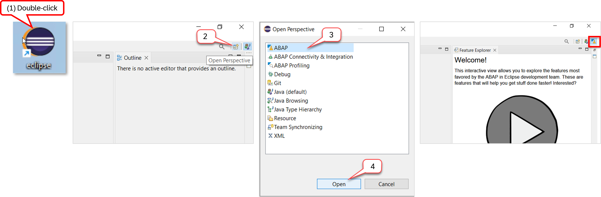

2. From the **File** menu select **New** > **ABAP Project**

3. Click on the entry **HE4**

   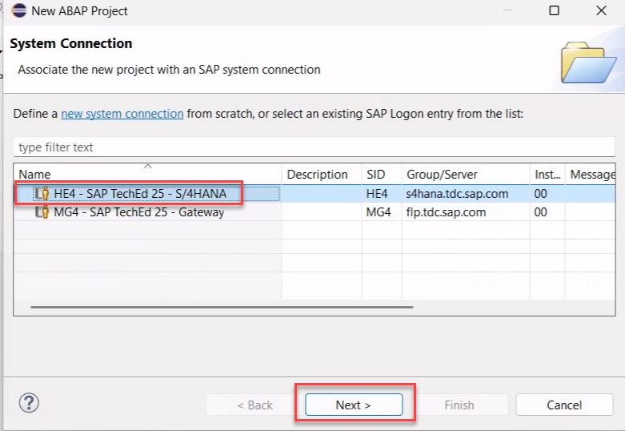 

4. In the **Connection Settings** dialogue leave the values unchanged and press **> Next**:  

   | Field | Value |
   |---|---|
   | System ID | **`HE4`**  |
   | Connection Type | **`Custom Application Server`**  |
   | Application Server | **`s4hana.tdc.sap.com`**  |
   | Instance Number | **`00`**  |
   | Activate Secure Network Communication (SNC) | Leave the checkbox ⏹️ unchecked |
   | | |
    
   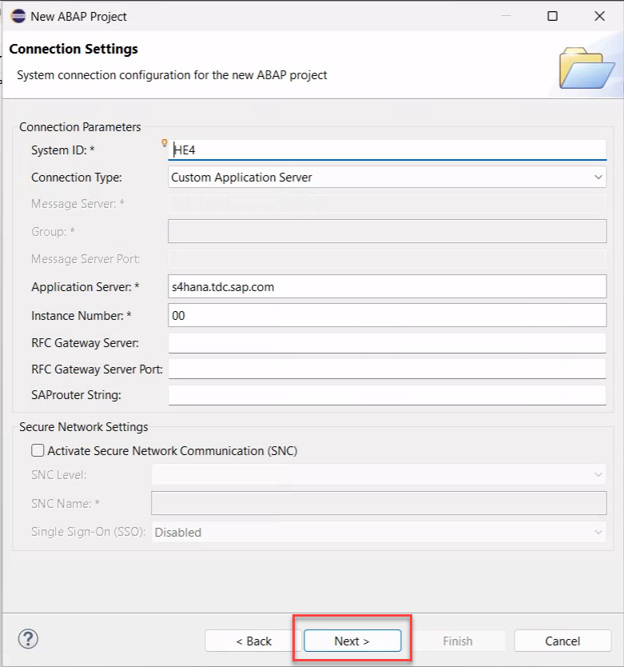 

5. In the log on to system dialogue enter the following values. Do **NOT** press _Finish_ but press _> Next_ instead.

   | Field | Value |
   |---|---|
   | Client | **`400`** |
   | User | **`TM364-###`** |
   | Password | **`xxxxxx`** (the password will be shared by the instructors) |
   | Language | **`EN`** |  
   | | |

   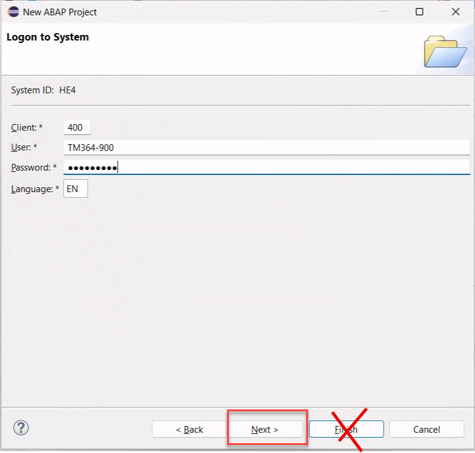 

<!--

later for codejams replace step 3., 4. and 5. by the following 

3. Click on the link **new system connection**

   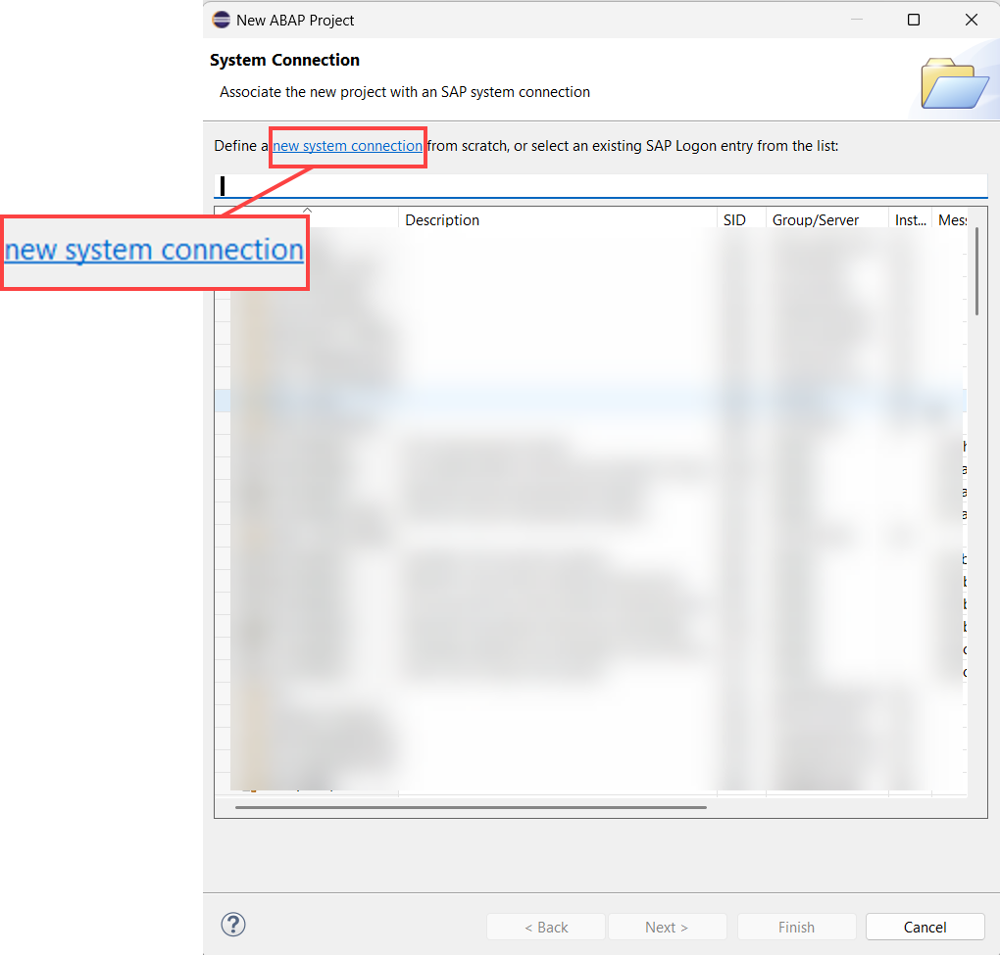 

4. In the **Connection Settings** dialogue enter the following values and press **> Next**:  

   | Field | Value |
   |---|---|
   | System ID | **`XXX`** (the SID will be shared by the instructors) |
   | Connection Type | **`Custom Application Server`** (to be selected from the drop down menu) |
   | Application Server | **`xxx.xxx.xxx.xxx`** (the IP address will be shared by the instructors) |
   | Instance Number | **`##`** (the Instance Number will be shared by the instructors) |
   | Activate Secure Network Communication (SNC) | Uncheck the checkbox ⏹️ |
   | | |
     
   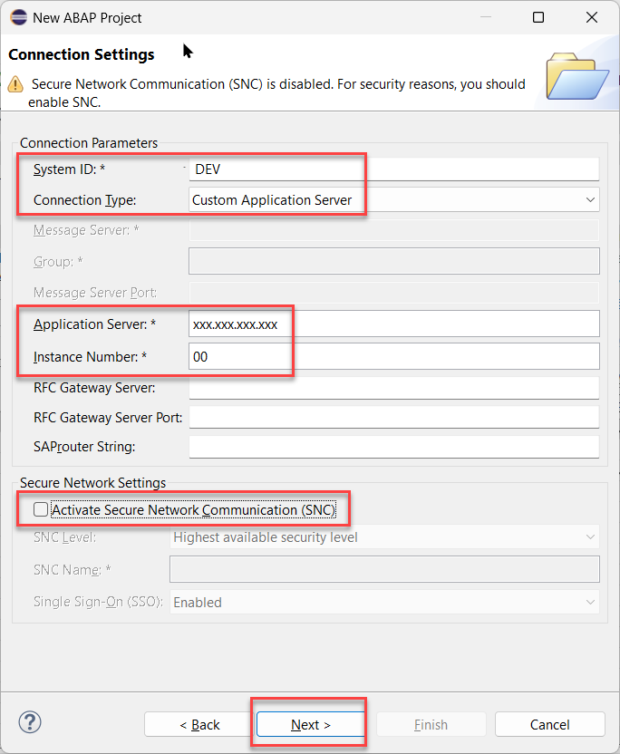 

5. In the log on to system dialogue enter the following values. Do **NOT** press _Finish_ but press _> Next_ instead.

   | Field | Value |
   |---|---|
   | Client | **`100`** |
   | User | **`TM364-###`** |
   | Password | **`xxxxxx`** (the password will be shared by the instructors) |
   | Language | **`EN`** |  
   | | |

   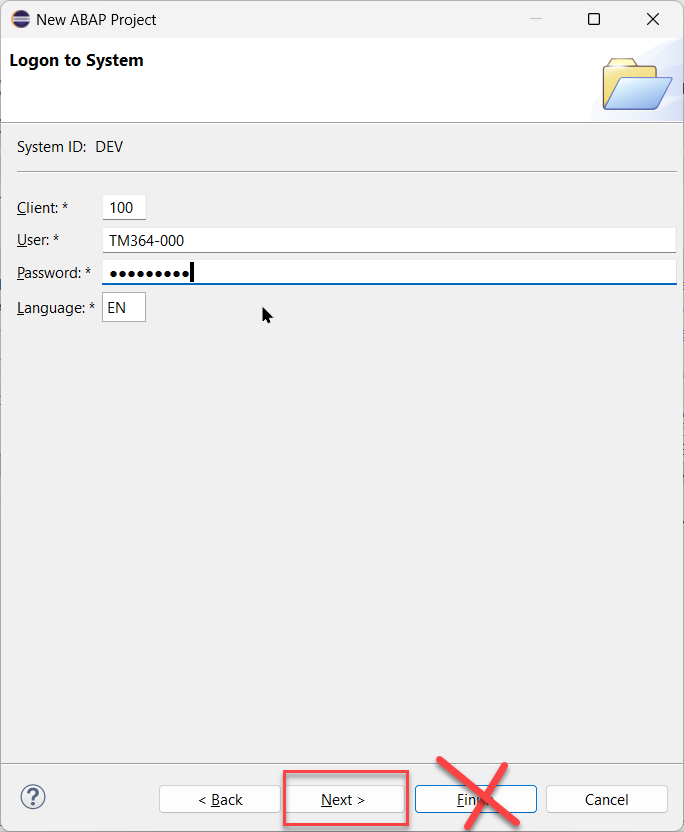 

-->

6. In the **Project Name** dialogue enter **`TM364`** as the project name and press **Finish**.  

   | Field | Value |
   |---|---|
   | Project Name | **`TM364`** |   
   | | |

   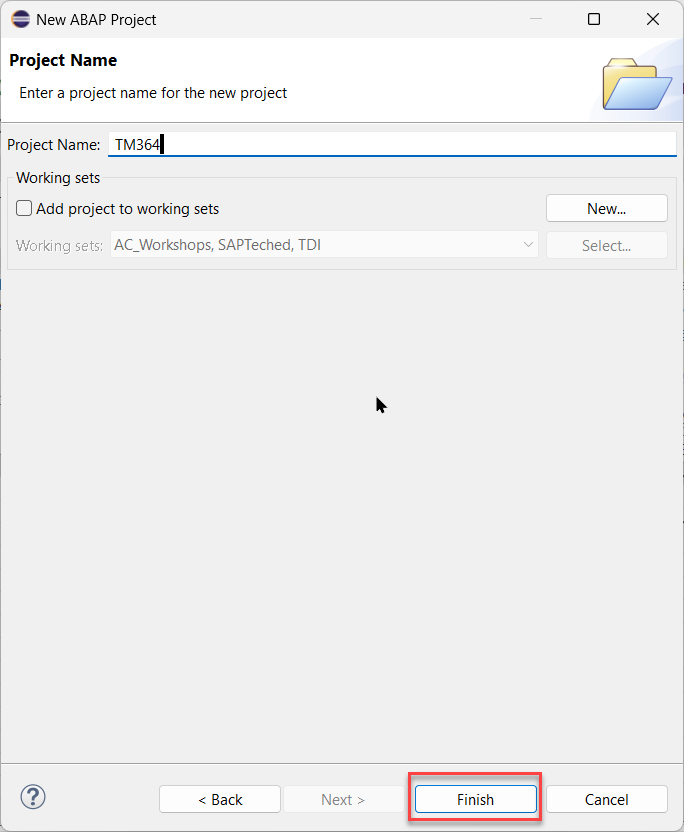   

7. You have now created a new ADT project. 

   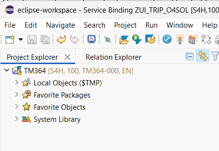 

## Summary & Next Exercise
[^Top of page](#)

Now that you've...
- connect to the ABAP environment,
- chosen your unique suffix **`###`**, and
- verified your development environment is ready,

you can continue with the next exercise – **[Exercise 1: Test a preconfigured ISLM scenario](../ex01/README.md)**.

---

## Helpful Information
[^Top of page](#)

This section contains some helpful information for the exercises: _Find/Replace_ functionality, modern ABAP syntax, and useful ADT shortcuts.

  
🔵 Click to expand!

### Working with Github

Here are a few tips to complete this exercise on GitHub.

  
🔵 Click to expand!

  
  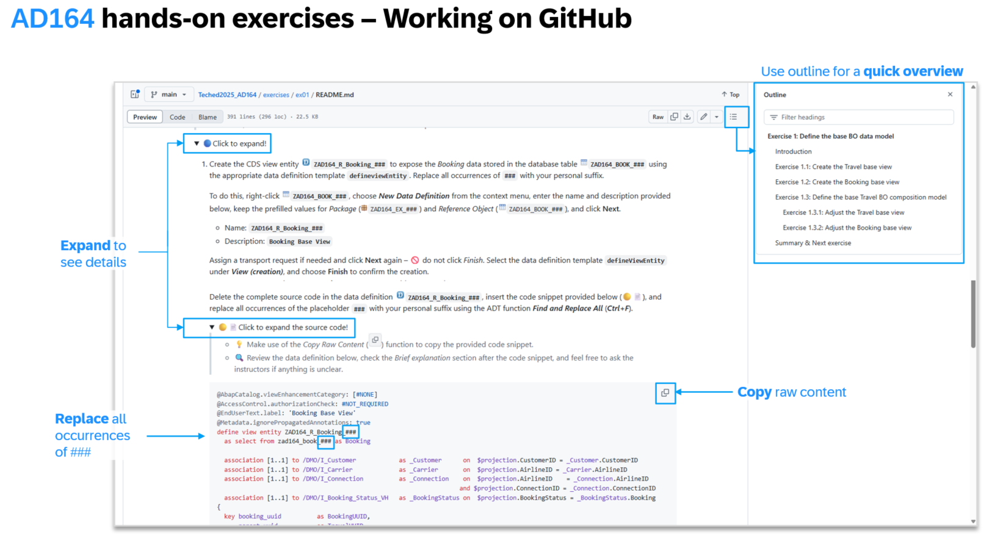 

 
### Find/Replace
In the course of these exercises you will frequently see the task to "_replace the placeholder **`###`** with your assigned suffix_", where *###* is your assigned suffix. 

For this it's recommended to make use of the **Find/Replace** feature of the Eclipse Editor. It can be opened either via the menu (**_Edit -> Find/Replace..._**) or via **Ctrl+F**.
  
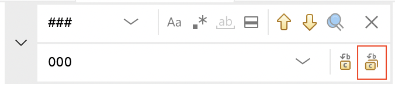
   
Choosing **Replace All** allows you to replace all occurrences of **`###`** with your assigned suffix.

### ABAP Pretty Printer (ABAP Formatter)

You can make use of the shortcut **`Shift + F1`** to format your source code. You may need to configure on first use.

### Modern ABAP Syntax
The modern, declarative, and expression-oriented ABAP language syntax will be used in the different exercises. It allows developers to write more simple and concise source code using new language features like inline declarations, constructor expressions.

> **Find more information in the ABAP Keyword Documentation**: [ABAP - Programming Language](https://help.sap.com/doc/abapdocu_cp_index_htm/CLOUD/en-US/index.htm?file=abenabap_reference.htm) 
  
### Useful ADT Shortcuts
Below are some useful ADT keyboard shortcuts for the ABAP development in Eclipse. More useful ADT shortcuts can be found on the [SAP Help Portal documentation](https://help.sap.com/docs/abap-cloud/abap-development-tools-user-guide/keyboard-shortcuts-for-abap-development).

When working in the ABAP Development Tools for Eclipse, you can display the full list of available shortcuts in the **Show Key Assist** in ADT by pressing **Ctrl+Shift+L**.

> [!NOTE]  
> When working on a Mac notebooks, use the **_Command_** (**Cmd**) instead of the **_Control_** key (**Ctrl**) used on Windows devices.

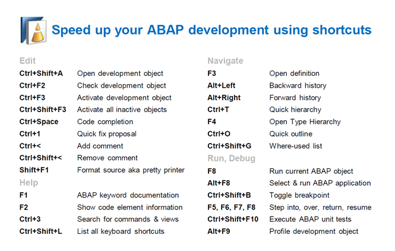
 

 

## Summary & Next Exercise
[^Top of page](#)

Now you've familiarized yourself with the solutions and your exercise package `ZTM364_###`, where `###` is your personal suffix.

Continue with the next exercise — **[Exercise 1: Test a preconfigured ISLM scenario](../ex01/README.md)**.

---

