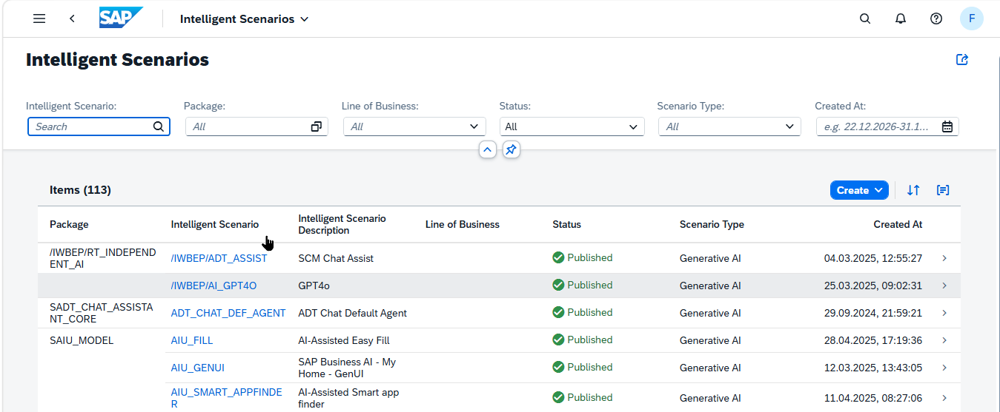
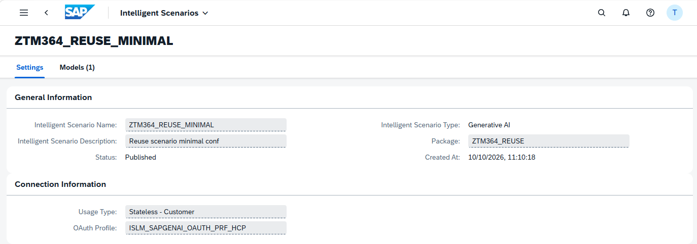
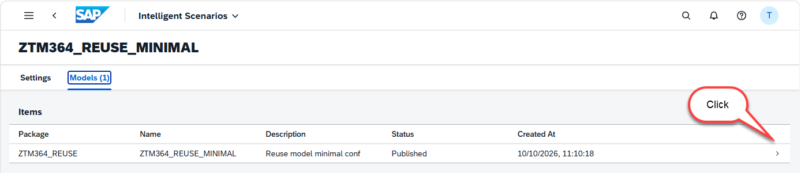
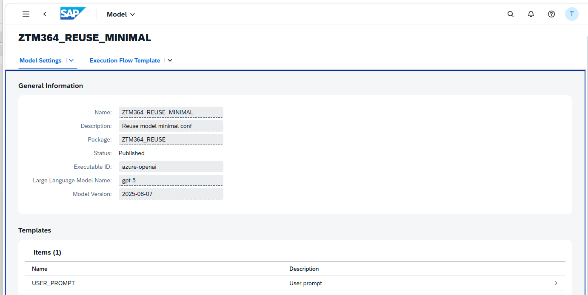
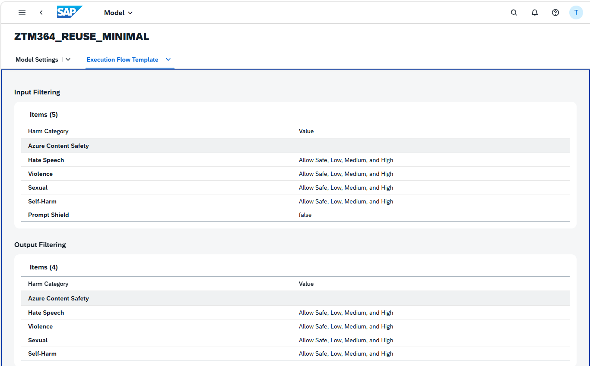
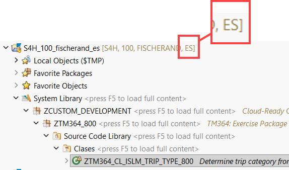
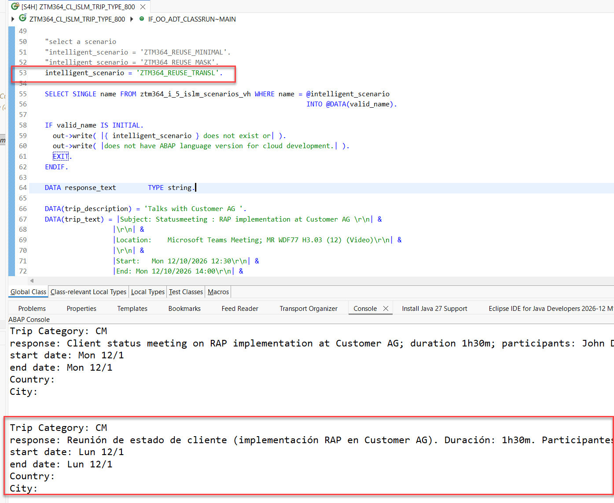

[Home - TM364](../../#exercises)

# Exercise 1: Test a Preconfigured ISLM Scenario

In this exercise you will develop a class that uses a simple ISLM scenario to categorize a trip based on input of the title and of text extracted from a meeting request provided to the LLM.

The class offers a method `get_trip_type()` that has three input parameters:  
-	**i_title** to provide a _Trip title_
- **i_details** to provide details e.g. from an email of a calendar entry
- **i_islm_scenario** can be used to try out different _ISLM scenarios_ of type GENAI

The method returns six parameters: 
- **e_response** contains a summary provided by the LLM 
-	**e_category** contains the two character	trip category. The _name_ of the category can be retrieved via the view entity [ztm364_i_trip_type](adt://S4H/sap/bc/adt/ddic/ddl/sources/ztm364_i_islm_scenarios_vh?version=active). 
- **e_startdate**	Start date of the trip
- **e_enddate**	End date of the trip
- **e_city**	Destination of the trip
- **e_country**	Country code of the country being visited


In **[Exercise 4](../ex04/README.md)**, we will then re-use this class in the implementation of a determination of your RAP business object for trip management. This way the code of the behavior implementation class is being refactored and at the same time it is easier to generate appropriate unit tests.

To be able to try out the effect of using different ISLM scenarios, this RAP BO will offer a value help to select one ISLM scenario of your choice for each single trip. 

# Exercises

- [1.1 - Check the pre-configured ISLM Scenario](#exercise-11-check-the-pre-configured-islm-scenario)
- [1.2 - Create your Exercise Package](#exercise-12-create-your-exercise-package)
- [1.3 - Create a class to call a Large Language Model via the ABAP AI SDK](#exercise-13-create-a-class-to-call-a-large-language-model-via-the-abap-ai-sdk)
- [1.4 - Test the class](#exercise-14-test-the-class)
- [1.5 - Test the class - 'ZTM364_REUSE_MASK'](#exercise-15-test-the-class---ztm364_reuse_mask)
- [1.6 - Test the class - 'ZTM364_REUSE_TRANSL'](#exercise-16-test-the-class---ztm364_reuse_transl)
- [Summary & Next Exercise](#summary--next-exercise)

> ℹ️ **Reminder**: Don't forget to replace all occurrences of the placeholder **`###`** with your group ID in the exercise steps below.

## Exercise 1.1: Check the Pre-Configured ISLM Scenario

Using the built in Fiori App **Intelligent Scenarios** you can have a look at the details of Intelligent Scenarios in your system. The application shows both, ISLM scenarios that have been delivered by SAP, and ISLM scenarios that have been built by customers. 

|||

The Intelligent Scenarios App can either be started via the Fiori Launchpad or using transaction code **F4469** from within SAPGUI. The app not only offers read access but also the option to create your own ISLM scenarios.   

We will start by investigating the custom ISLM scenarios that have been pre-created for your convenience.

<details>
  <summary>🔵 Click to expand!</summary>

1. Open the following link **in a new window** to the [Intelligent Scenarios App](https://s4hana.tdc.sap.com:50081/sap/bc/ui2/flp?sap-client=400&sap-language=EN#IntelligentScenario-register&/SIDEBYSIDE/ZTM364_REUSE_MINIMAL)

   

2. You have to authenticate using your user name `TM364-###` and password `<provided by the instructors>`.  

3. We start with the **Settings** of the ISLM scenario `ZTM364_REUSE_MINIMAL` which is of type **Generative AI**.  


   

4. Navigate to the **Models** tab and click on the **>** to open the model details.

   

5. The **Model settings** will be opened which shows that our model contains a user prompt template.      

   

6. Finally we can navigate to the **Execution Flow Template** tab 

   

7. Navigating back to the overview page [Intelligent Scenarios](https://s4hana.tdc.sap.com:50081/sap/bc/ui2/flp?sap-client=400&sap-language=EN#IntelligentScenario-register) you can search for the pre-configured scenarios by entering the search string `ZTM364' and find out about the settings of the other pre-configured scenarios:

   - ZTM364_REUSE_MINIMAL  
   - ZTM364_REUSE_TRANSL  
   - ZTM364_REUSE_MASK  
   - ZTM364_REUSE_GROUND 
   - ZTM364_REUSE_NO_ORCH  

</details>

## Exercise 1.2: Create Your Exercise Package
[^Top of page](#)

> Create your exercise package `ZTM364_###` to group all artefacts that you will create in this exercise.
> 
> 💡 Remember to replace all occurrences of the suffix placeholder `###` with your personal suffix in all exercise steps. 

<details>
  <summary>🔵 Click to expand!</summary>

1. In ADT, go to the **Project Explorer**, right-click on the **`Favorite Packages`**, and select **New** > **ABAP Package** from the context menu. 

2. Enter the following values:

   | Field | Value |
   |---|---|
   | Name | **`ZTM364_###`** |
   | Description | **`TM364: Exercise Package (###)`** |
   | Add to favorite packages | `☑️` Select the box  |
   | Superpackage | **`ZCUSTOM_DEVELOPMENT`** |

3. Click **Next >**, create a transport request if required, then click **Finish** to confirm the creation.

<br/>

</details>

## Exercise 1.3: Create a Class to Call a Large Language Model via the ABAP AI SDK
[^Top of page](#)

> In this exercise you will create a class  `ztm364_cl_islm_trip_type_###` to call a Large Language Model via the ABAP AI SDK. The source code has been provided for your convenience in the following section.

1. Right-click on your package  **`ZTM364_###`** and select **New** > **ABAP Class**.

2. Enter the following values:

   | Field | Value |
   |---|---|
   | Name | **`ztm364_cl_islm_trip_type_###`** |
   | Description | **`Determine trip category from description and trip details`** |

3. Replace the complete class definition with the 📄source code provided below,   
   and replace all occurrences of the placeholder **`###`** with your personal suffix using **Ctrl+F**.

4. Save  (**Ctrl+S**) and activate  (**Ctrl+F3**) the changes.

 >💡**Hints**:  
      - Replace all occurrences of the placeholder **`###`** with your personal suffix using _**Find and Replace All**_ function (**Ctrl+F**)  
      - Use the **ABAP Formatter** function (**Shift+F1**) to format your source code  
        (You may need to configure the _ABAP Formatter_ and the _DDL Formatter_ if using them for the first time in a given system under the Eclipse menu **Window > Preferences** and navigate to **ABAP Development > Source Code Editor** to configure the _**ABAP Formatter**_.)
    

<details>
     <summary>🟡📄 Click to expand the source code!</summary>

          
  
   ```abap 

   CLASS ztm364_cl_islm_trip_type_### DEFINITION
 PUBLIC
 FINAL
 CREATE PUBLIC .

  PUBLIC SECTION.

    INTERFACES if_oo_adt_classrun .

    "! Determine trip type by LLM<br/>
    "! <br/>
    "! @parameter i_title | Trip title
    "! @parameter i_details | Details e.g. from a calendar entry
    "! @parameter i_islm_scenario | Name of an ISLM scenario of type GENAI
    "! @parameter e_response      | Summary provided by the LLM
    "! @parameter e_category | trip category. Name can be retrieved via {@link ZTM364_I_Trip_Type}
    "! @parameter e_startdate | Start date of the trip
    "! @parameter e_enddate | End date of the trip
    "! @parameter e_city | Destination of the trip
    "! @parameter e_country | Code of the country being visited
    METHODS get_trip_type IMPORTING i_title         TYPE string OPTIONAL
                                    i_details       TYPE string OPTIONAL
                                    i_islm_scenario TYPE aic_islm_scenario_id=>type
                          EXPORTING e_response      TYPE string
                                    e_category      TYPE ZTM364_I_Trip_Type-Type
                                    e_startdate     TYPE datn
                                    e_enddate       TYPE datn
                                    e_city          TYPE string
                                    e_country       TYPE string.

  PROTECTED SECTION.
  PRIVATE SECTION.

    TYPES: BEGIN OF ty_event_type,
             type        TYPE c LENGTH 2,
             description TYPE string,
           END OF ty_event_type,
           ty_event_types TYPE STANDARD TABLE OF ty_event_type WITH EMPTY KEY.

ENDCLASS.


CLASS ztm364_cl_islm_trip_type_### IMPLEMENTATION.
  METHOD if_oo_adt_classrun~main.

    "abap cloud
    DATA intelligent_scenario TYPE aic_islm_scenario_id=>type.

    "select a scenario
    intelligent_scenario = 'ZTM364_REUSE_MINIMAL'.
    "intelligent_scenario = 'ZTM364_REUSE_MASK'.
    "intelligent_scenario = 'ZTM364_REUSE_TRANSL'.

    SELECT SINGLE name FROM ztm364_i_5_islm_scenarios_vh WHERE name = @intelligent_scenario
                                                                      INTO @DATA(valid_name).

    IF valid_name IS INITIAL.
      out->write( |{ intelligent_scenario } does not exist or| ).
      out->write( |does not have ABAP language version for cloud development.| ).
      EXIT.
    ENDIF.

    DATA response_text        TYPE string.

    DATA(trip_description) = 'Talks with Customer AG '.


    DATA(trip_text) = |Subject: Statusmeeting with Customer AG : RAP implementation at Customer AG \r\n| &
                  |\r\n| &
                  |Location: Microsoft Teams Meeting; Walldorf, MR WDF77 H3.03 (12) (Video)\r\n| &
                  |\r\n| &
                  |Start:   Mon 12/10/2026 12:30\r\n| &
                  |End: Mon 12/10/2026 14:00\r\n| &
                  |\r\n| &
                  |Recurrence:  (none)\r\n| &
                  |\r\n| &
                  |Meeting Status:  Meeting organizer\r\n| &
                  |\r\n| &
                  |Organizer:   Doe, John\r\n| &
                  |Required Attendees:  Doe, John; Major, Mary\r\n| &
                  |Resources:   MR WDF77 H3.03 (12) (Video)\r\n| &
                  |\r\n| &
                  |Categories:  SAP internal event\r\n| &
                  |\r\n| &
                  |Topics: \r\n| &
                  |- Dicuss prices for next offer\r\n| &
                  |- List of customer tickets\r\n| &
                  |- Next steps|.


    get_trip_type( EXPORTING i_title        = CONV #( trip_description )
                            i_details          = trip_text
                            i_islm_scenario = intelligent_scenario
                  IMPORTING e_response      = response_text
                            e_category      = DATA(trip_category)
                            e_enddate       = DATA(enddate)
                            e_startdate     = DATA(startdate)
                            e_country       = DATA(country)
                            e_city          = DATA(city)
                               ).

    out->write( |Trip Category: { trip_category }|  ).
    out->write( |response: { response_text }|  ).
    out->write( |start date: { startdate }|  ).
    out->write( |end date: { enddate }|  ).
    out->write( |Country: { country }|  ).
    out->write( |City: { city }|  ).

  ENDMETHOD.

  METHOD get_trip_type.
    "we use technical property names to avoid problems when
    "the LLM response is being translated
    TYPES:
      BEGIN OF t_trip_categorization,
        p1 TYPE string, "tripcategory
        p2 TYPE string, "summary
        p3 TYPE string, "country
        p4 TYPE string, "city
        p5 TYPE datn, "startdate
        p6 TYPE datn, "enddate
      END OF t_trip_categorization.

    DATA result_get_trip_type TYPE t_trip_categorization.
    DATA event_types          TYPE ty_event_types.
    DATA error_text           TYPE string.

    SELECT type, description FROM ZTM364_I_Trip_Type
      INTO CORRESPONDING FIELDS OF TABLE @event_types.

    TRY.

        DATA(prompt_string) = |Derive a trip category based on the given trip title: { i_title }| &&
                              |The following trip categories exist: { cl_abap_char_utilities=>cr_lf }|.

        LOOP AT event_types INTO DATA(event_type).
          prompt_string = |{ prompt_string }{ event_type-type } ({ event_type-description }) |.
        ENDLOOP.

        IF i_details IS NOT INITIAL.
          prompt_string = |{ prompt_string }Also use this more detailed information to derive the category|.
          prompt_string = |{ prompt_string }{ i_details }|.
        ENDIF.

        prompt_string = |{ prompt_string }Please provide two character code for the TripCategory.|.

        prompt_string = |{ prompt_string }and an provide if possible short summary of that trip (duration, participants, topics).|.

        prompt_string = |{ prompt_string }Do NOT wrap the response in markdown. Respond in valid JSON.{ cl_abap_char_utilities=>cr_lf }|.
        prompt_string = |{ prompt_string } The following properties are being used in the JSON. { cl_abap_char_utilities=>cr_lf }|
                     && |p1 contains the "TripCategory", p2 contains the "Summary", { cl_abap_char_utilities=>cr_lf }|
                     && |p3 contains the "Country", p4 contains the "City"  { cl_abap_char_utilities=>cr_lf }|
                     && |, p5 contains the "StartDate" , p6 contains the "EndDate".  { cl_abap_char_utilities=>cr_lf }|
                     && |\{ { cl_abap_char_utilities=>cr_lf }|
                     && |"p1" :"",{ cl_abap_char_utilities=>cr_lf }|
                     && |"p2" :"",{ cl_abap_char_utilities=>cr_lf }|
                     && |"p3" :"",{ cl_abap_char_utilities=>cr_lf }|
                     && |"p4" :"",{ cl_abap_char_utilities=>cr_lf }|
                     && |"p5" :"",{ cl_abap_char_utilities=>cr_lf }|
                     && |"p6" :"",{ cl_abap_char_utilities=>cr_lf }|
                     && |\}{ cl_abap_char_utilities=>cr_lf }|.


        DATA(api) = cl_aic_islm_orch_api_factory=>get( )->create_instance( islm_scenario = i_islm_scenario ).

        api->configure_templating( )->add_user_message( message = prompt_string ).

        FINAL(response) = api->execute( )->orchestration_result( )->completion( ).

        /ui2/cl_json=>deserialize( EXPORTING json        = response
                                             pretty_name = /ui2/cl_json=>pretty_mode-camel_case
                                   CHANGING  data        = result_get_trip_type ).

        "mapping back to readable property names
        e_category = result_get_trip_type-p1.
        e_response = result_get_trip_type-p2.
        e_country = result_get_trip_type-p3.
        e_city     = result_get_trip_type-p4.
        e_startdate = result_get_trip_type-p5.
        e_enddate = result_get_trip_type-p6.

      CATCH cx_aic_api_factory
            cx_aic_prompt_template
            cx_aic_completion_api
            cx_root INTO DATA(aic_exception).
        error_text = aic_exception->get_text( ).
        e_category = '##'.
        e_response = |Error occurred. \r\n { error_text }|.
    ENDTRY.
  ENDMETHOD.

ENDCLASS.

 ```
  </details>

<!--

<details>
     <summary>🟡📄 Click to expand the source code!</summary>

          
  
   ```abap   
   CLASS ztm364_cl_islm_trip_type_### DEFINITION
   PUBLIC
   FINAL
   CREATE PUBLIC .

   PUBLIC SECTION.

    INTERFACES if_oo_adt_classrun .

    "! Determine trip type by LLM<br/>
    "! <br/>
    "! @parameter i_title | Trip title
    "! @parameter i_details | Details e.g. from a calendar entry
    "! @parameter i_islm_scenario | Name of an ISLM scenario of type GENAI
    "! @parameter e_response      | Summary provided by the LLM
    "! @parameter e_category | trip category. Name can be retrieved via {@link ZTM364_I_Trip_Type}
    "! @parameter e_startdate | Start date of the trip
    "! @parameter e_enddate | End date of the trip
    "! @parameter e_city | Destination of the trip
    "! @parameter e_country | Code of the country being visited
    METHODS get_trip_type IMPORTING i_title         TYPE string OPTIONAL
                                    i_details       TYPE string OPTIONAL
                                    i_islm_scenario TYPE aic_islm_scenario_id=>type
                          EXPORTING e_response      TYPE string
                                    e_category      TYPE ZTM364_I_Trip_Type-Type
                                    e_startdate     TYPE datn
                                    e_enddate       TYPE datn
                                    e_city          TYPE string
                                    e_country       TYPE string.

   PROTECTED SECTION.
   PRIVATE SECTION.

    TYPES: BEGIN OF ty_event_type,
             type        TYPE c LENGTH 2,
             description TYPE string,
           END OF ty_event_type,
           ty_event_types TYPE STANDARD TABLE OF ty_event_type WITH EMPTY KEY.

   ENDCLASS.


   CLASS ztm364_cl_islm_trip_type_### IMPLEMENTATION.
   METHOD if_oo_adt_classrun~main.

    "abap cloud
    DATA intelligent_scenario TYPE aic_islm_scenario_id=>type.

    "select a scenario
    intelligent_scenario = 'ZTM364_REUSE_MINIMAL'.
    "intelligent_scenario = 'ZTM364_REUSE_MASK'.
    "intelligent_scenario = 'ZTM364_REUSE_TRANSL'.

    SELECT SINGLE name FROM ztm364_i_5_islm_scenarios_vh WHERE name = @intelligent_scenario
                                                                      INTO @DATA(valid_name).

    IF valid_name IS INITIAL.
      out->write( |{ intelligent_scenario } does not exist or| ).
      out->write( |does not have ABAP language version for cloud development.| ).
      EXIT.
    ENDIF.

    DATA response_text        TYPE string.

    DATA(trip_description) = 'Talks with Customer AG '.
    DATA(trip_text) = |Subject: Statusmeeting : RAP implementation at Customer AG \r\n| &
                     |\r\n| &
                     |Location:    Microsoft Teams Meeting; MR WDF77 H3.03 (12) (Video)\r\n| &
                     |\r\n| &
                     |Start:   Mon 12/10/2026 12:30\r\n| &
                     |End: Mon 12/10/2026 14:00\r\n| &
                     |\r\n| &
                     |Recurrence:  (none)\r\n| &
                     |\r\n| &
                     |Meeting Status:  Meeting organizer\r\n| &
                     |\r\n| &
                     |Organizer:   Doe, John\r\n| &
                     |Required Attendees:  Doe, John; Major, Mary\r\n| &
                     |Resources:   MR WDF77 H3.03 (12) (Video)\r\n| &
                     |\r\n| &
                     |Categories:  SAP internal event\r\n| &
                     |\r\n| &
                     |Topics: \r\n| &
                     |- Dicuss prices for next offer\r\n| &
                     |- List of customer tickets\r\n| &
                     |- Next steps|.

    get_trip_type( EXPORTING i_title        = CONV #( trip_description )
                            i_details          = trip_text
                            i_islm_scenario = intelligent_scenario
                  IMPORTING e_response      = response_text
                            e_category      = DATA(trip_category)
                            e_enddate       = DATA(enddate)
                            e_startdate     = DATA(startdate)
                            e_country       = DATA(country)
                            e_city          = DATA(city)
                               ).

    out->write( |Trip Category: { trip_category }|  ).
    out->write( |response: { response_text }|  ).
    out->write( |start date: { startdate }|  ).
    out->write( |end date: { enddate }|  ).
    out->write( |Country: { country }|  ).
    out->write( |City: { city }|  ).

   ENDMETHOD.

  METHOD get_trip_type.
    TYPES:
      BEGIN OF t_trip_categorization,
        tripcategory TYPE string,
        summary      TYPE string,
        country      TYPE string,
        city         TYPE string,
        startdate    TYPE datn,
        enddate      TYPE datn,
      END OF t_trip_categorization.

    DATA result_get_trip_type TYPE t_trip_categorization.
    DATA event_types          TYPE ty_event_types.
    DATA error_text           TYPE string.

    SELECT type, description FROM ZTM364_I_Trip_Type
      INTO CORRESPONDING FIELDS OF TABLE @event_types.

    TRY.

        DATA(prompt_string) = |Derive a trip category based on the given trip title: { i_title }| &&
                              |The following trip categories exist: { cl_abap_char_utilities=>cr_lf }|.

        LOOP AT event_types INTO DATA(event_type).
          prompt_string = |{ prompt_string }{ event_type-type } ({ event_type-description }) |.
        ENDLOOP.

        IF i_details IS NOT INITIAL.
          prompt_string = |{ prompt_string }Also use this more detailed information to derive the category|.
          prompt_string = |{ prompt_string }{ i_details }|.
        ENDIF.

        prompt_string = |{ prompt_string }Please provide two character code for the TripCategory.|.

        prompt_string = |{ prompt_string }and an provide if possible short summary of that trip (duration, participants, topics).|.

        prompt_string = |{ prompt_string }Do NOT wrap the response in markdown. Respond in valid JSON.{ cl_abap_char_utilities=>cr_lf }|
                     && |\{ { cl_abap_char_utilities=>cr_lf }|
                     && |"TripCategory" :"",{ cl_abap_char_utilities=>cr_lf }|
                     && |"Summary" :"",{ cl_abap_char_utilities=>cr_lf }|
                     && |"StartDate" :"",{ cl_abap_char_utilities=>cr_lf }|
                     && |"EndDate" :"",{ cl_abap_char_utilities=>cr_lf }|
                     && |"Country" :"",{ cl_abap_char_utilities=>cr_lf }|
                     && |"City" :"",{ cl_abap_char_utilities=>cr_lf }|
                     && |\}{ cl_abap_char_utilities=>cr_lf }|.

        DATA(api) = cl_aic_islm_orch_api_factory=>get( )->create_instance( islm_scenario = i_islm_scenario ).

        api->configure_templating( )->add_user_message( message = prompt_string ).

        FINAL(response) = api->execute( )->orchestration_result( )->completion( ).

        /ui2/cl_json=>deserialize( EXPORTING json        = response
                                             pretty_name = /ui2/cl_json=>pretty_mode-camel_case
                                   CHANGING  data        = result_get_trip_type ).

        e_response = result_get_trip_type-summary.
        e_category = result_get_trip_type-tripcategory.
        e_city     = result_get_trip_type-city.
        e_country = result_get_trip_type-country.
        e_startdate = result_get_trip_type-startdate.
        e_enddate = result_get_trip_type-enddate.

      CATCH cx_aic_api_factory
            cx_aic_prompt_template
            cx_aic_completion_api
            cx_root INTO DATA(aic_exception).
        error_text = aic_exception->get_text( ).
        e_category = '##'.
        e_response = |Error occurred. \r\n { error_text }|.
    ENDTRY.
   ENDMETHOD.

   ENDCLASS.

    
   ```
  </details>
     
-->

## Exercise 1.4: Test the Class

1. Check the content of the `main()` method of your class. 

   In the `main()` method a `trip_description` is being provided as well as a `trip_text`. In addition an intelligent scenario can be chosen. All of these variables are then passed to the `get_trip_type` method. This method constructs a prompt asking the LLM to provide the values for the given parameters `Trip Category`, `response`, `start date`, `end-date`, `Country`, and `City` based on the input. 

2. Execute the class as **Console App** by pressing **F9**.

   After a few seconds, you should receive a response like the following:

   >Trip Category: CM  
   >response: Client status meeting (RAP implementation) with Customer AG; duration 1h30m; participants: John Doe (organizer), Mary Major, Customer AG; topics: pricing for next offer, list of customer tickets, next steps.
   >start date: 20261012  
   >end date: 20261012  
   >Country: Germany  
   >City: Walldorf   

     
   This shows that ABAP AI SDK has sent the information that was provided via the title and the details to the LLM that is connected to the AI Core service in SAP Business AI Platform.  


3. Try out different ISLM scenarios by commenting in and out different values for the variable `intelligent_scenario`.  

```
   intelligent_scenario = 'ZTM364_REUSE_MINIMAL'.
   "intelligent_scenario = 'ZTM364_REUSE_MASK'.
   "intelligent_scenario = 'ZTM364_REUSE_TRANSL'.
```


## Exercise 1.5: Test the Class - 'ZTM364_REUSE_MASK'

1. Uncomment the value 'ZTM364_REUSE_MASK' and comment out the other values.
   
   ```
   "intelligent_scenario = 'ZTM364_REUSE_MINIMAL'.
   intelligent_scenario = 'ZTM364_REUSE_MASK'.
   "intelligent_scenario = 'ZTM364_REUSE_TRANSL'.
   ```
2. Run the class `ztm364_cl_islm_trip_type_###` again. 

3. You should notice that in case `ZTM364_REUSE_MASK` is used, certain values of the text will be anonymized. 

   The names of the participants **John Doe (organizer), Mary Major** are no longer visible.


   >**Anonymized response**:  
   > Trip Category: CM   
   response: Client status meeting on RAP implementation with Customer AG via Microsoft Teams/video room; duration 1h30 (12:30–14:00); participants: **organizer plus 2 required attendees;** topics: pricing for next offer, list of customer tickets, next steps.  
   start date: 12/10/20   
   end date: 12/10/20   
   Country:   
   City:   
   > You might also get a response such as **participants: MASKED_E, MASKED_E** instead of **organizer plus 2 required attendees;** .

## Exercise 1.6: Test the Class - 'ZTM364_REUSE_TRANSL'

When using the ISLM scenario 'ZTM364_REUSE_TRANSL' output translation is applied, so the response is translated into the user's current logon language.   

1. Create an ADT project with logon language Spanish `ES`.



2. Uncomment the value 'ZTM364_REUSE_TRANSL' and comment out the other values.
   
   ```
   "intelligent_scenario = 'ZTM364_REUSE_MINIMAL'.
   "intelligent_scenario = 'ZTM364_REUSE_MASK'.
   intelligent_scenario = 'ZTM364_REUSE_TRANSL'.
   ```


3. Run the class `ztm364_cl_islm_trip_type_###` again. This time the output in the console will be in Spanish.

   


## Summary & Next Exercise
[^Top of page](#)

Now that you've...
- created a class that can be used as API for trip categorization 
- experimented with different ISLM scenarios

you can continue with the next exercise – **[Exercise 2: Publish and Preview the Trip Expense App](../ex02/README.md)**

---
