[Home - TM364](../../#exercises)

# Exercise 2: Generate a RAP Business Object for Managing Trip Expenses

In this exercise, you will use your exercise package `ZTM364_###` to generate a transactional OData-based UI service for the Fiori elements-based Manage Trip Expenses app (henceforth _Trip App_) using the OData UI Service From Scratch Wizard manually. The Trip App will be based on a Trip BO with two entities Trip (root) and Expense (child).  
For both entities you will use structures as templates: `ztm364_trip_template` for the _Trip_ entity and `ztm364_expenses_template` for the child entity _Expense_.   

# Exercises

- [2.1 - Generate the Transactional UI Service](#exercise-21-generate-the-transactional-ui-service)
- [2.2 - Preview and test the Service](#exercise-22-preview-and-test-the-service)
- [Summary & Next Exercise](#summary--next-exercise)

## Exercise 2.1: Generate the Transactional UI Service
[^Top of page](#)

> Create a new transactional OData-based UI service based on a RAP BO with two node entities _Trip_ (as root entity) and _Expense_ using the RAP Generator in your exercise package  **`ZTM364_###`**. You will use the structures `ztm364_trip_template` and `ztm364_expenses_template` as templates for creating both BO node entities.

  
🔵 Click to expand!

> **Note:** In case you are using the OData UI Service from Scratch generator, make sure that you have applied SAP Notes for latest fixes and improvements. This has already been done for the system you are using during the TechEd 2026 Hands-On session. In case you use the tool in your own environment, make sure that e.g. **[SAP Note 3688541](https://me.sap.com/notes/3688541/E)** is implemented.

1. In ADT, right-click on your exercise package  **`ZTM364_###`**, select **Generate ABAP Repository Objects...** from the context menu.

   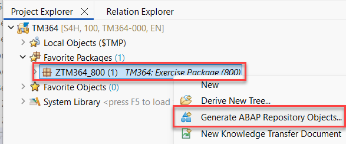  

2. You will get a pop-up with the title **Logon for Use Joule Side-by-Side for _Your ADT Project Name_"**.   
   Select **Open Logon Page in Browser**. 

3. Another window for the IAS for **Joule for developers, ABAP AI Capabilities** will open. Here you have to enter the following credentials and the press **Continue**.

   | Field | Value |
   |---|---|
   | Email or User Name | **`tm364-###@education.cloud.sap`** |
   | Password | **`xxxx`** (provided by the instructors) |

   > It might happen that the authentication does not work when you enter the credentials for the first time. In this case just enter them once again.

   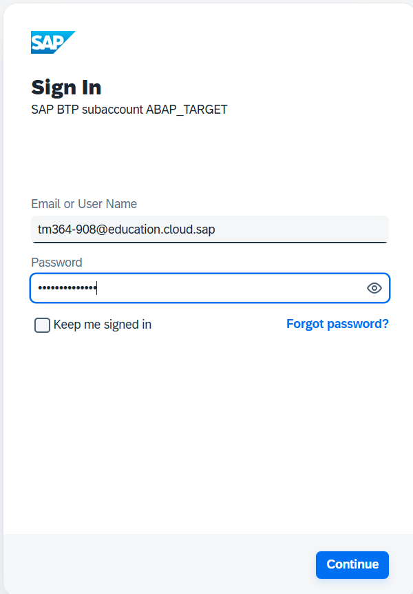 

4. Now you are able to select the Generator. Select the **OData UI Service from Scratch**, and press **Next**.

   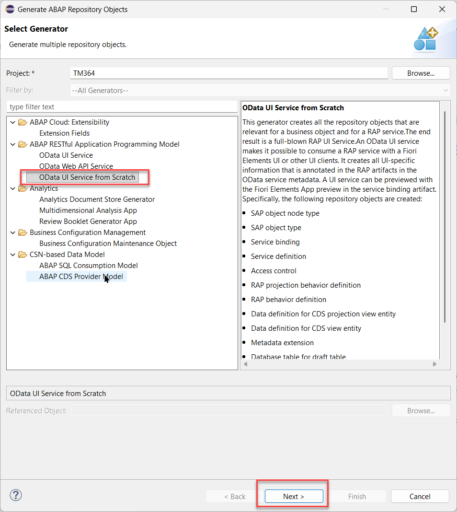

5. Now go ahead and configure the _Trip_ BO in the creation dialog. 

2. In the **Enter Package** screen just press **Next >**.

3. On the **Configure Generator** screen, enter the following values on the **Service Configuration** tab:

   | Field | Value |
   |---|---|
   | Artefact Suffix | **`###`** |
   | Project Name | **`Trip`** |

   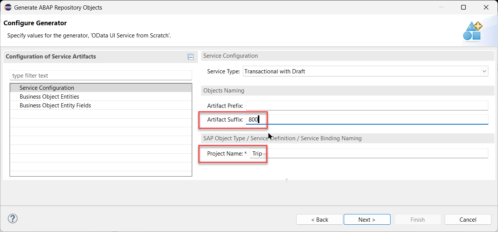 

4. Select the entry **Business Object Entities** (1) in the _Configuration of Service Artifacts_ section and then press the **Add** (2) button.

   In the **Add Business Entities** dialog, enter the following values to add the BO root entity **`Trip`** and configure it as shown in the table below (3). Press **Add** (4).
       
     | Field | Value |
     |---|---|
     | Entity Alias* | **`Trip`** |
     | Template | **`ztm364_trip_template`** |

     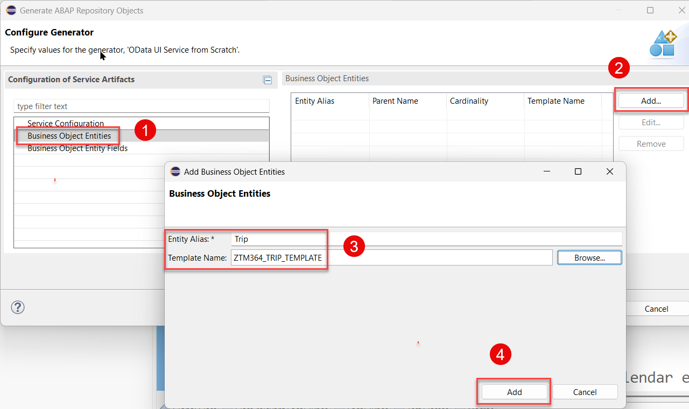 

5. The newly created entity **Trip** (1) is automatically selected. Simply press the **Add** (2) button again to add the BO child entity **`Expense`** and configure it as follows (3) and press **Add** (4).

     | Field | Value |
     |---|---|
     | Entity Alias* | **`Expense`** |
     | Parent Name | **`Trip`** |
     | Cardinality* | **`To Many`** |
     | Template Name | **`ztm364_expenses_template`** |

   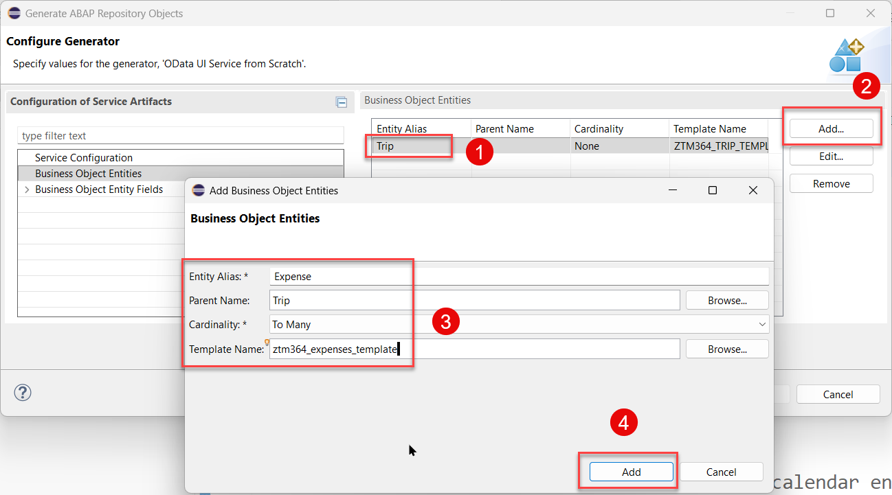 

<!--

6. We now want to adapt the field **`TripID`** the **_Trip_** entity so that it will be annotated as a sematic key.  
To do so, go to the **Business Object Entities Fields** tab to the **_Trip_** entity (1) to adapt the settings for the field **`TripID`** (2) using the **Edit...** button (3):
   
   Change the field **`TripID`** of the _Trip_ entity such that it will be annotated as a semantic key field - step (4). If required, move it at the top of the field list using the **Up** button. Click OK when finished.
     
     | Field | Value |
     |---|---|
     | Field Alias* | **`TripID`** |
     | Annotate as Semantic Key | `☑️` _Select the box_ |
     | | |
   
   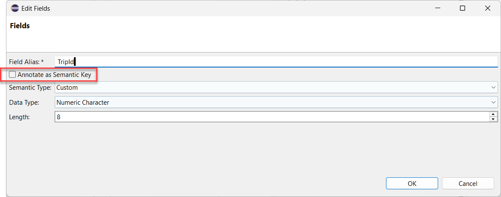 

   > Please note   
   > When you click on the check box **Annotate as semantic key** the data type is changed to **char** and **length 10**.

   Select the data type **Numeric Character** so that the original value becomes active again.

   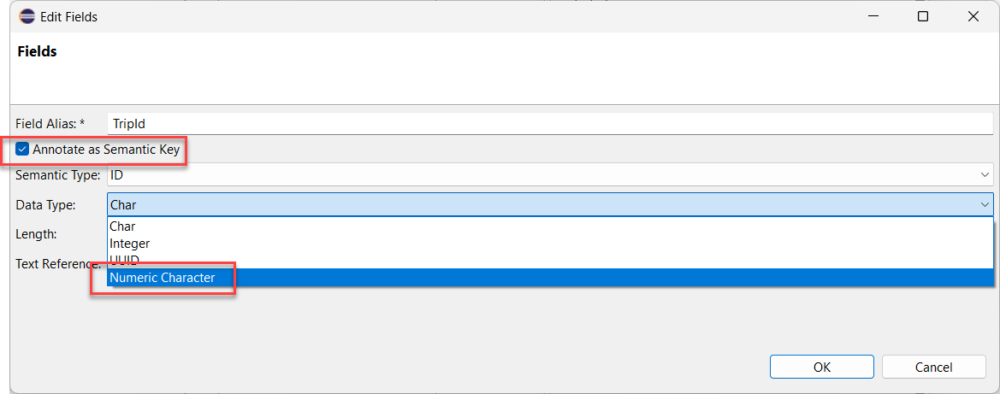
 
   The final result should look like follows

   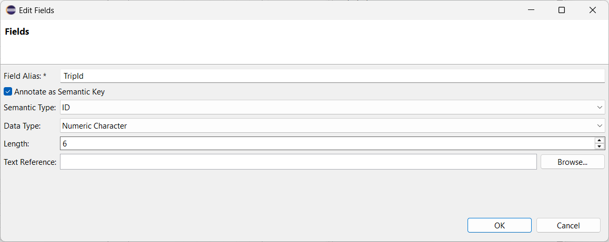

-->

7. Click **Next >** and review the artefacts to be generated.

   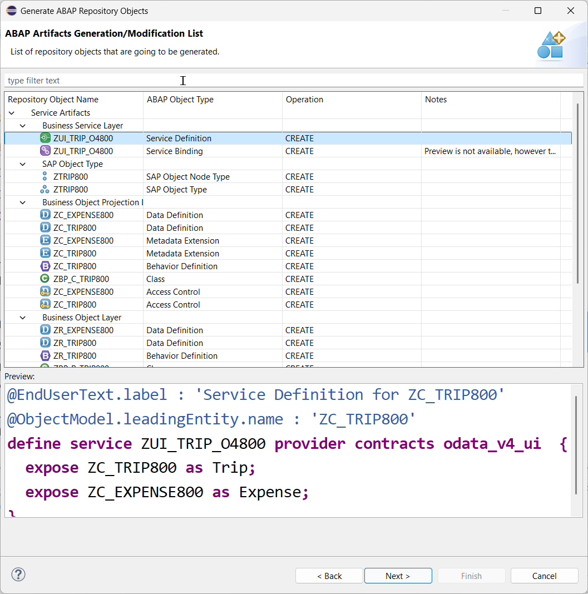 

8. Click **Next >**, create or choose a transport request if required, click **Next >** and confirm with **Finish** to generate all artefacts.

9. After a few seconds, click **Open** in the appearing dialog to open the generated object **`ZUI_TRIP_O4###`** in the service binding editor.

   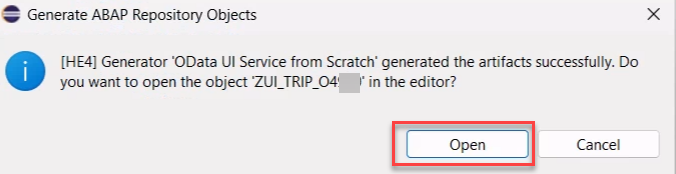   

  
<!--

10. You can refresh (**F5**) the package in the **Project Explorer** to load all generated development objects if not yet displayed after the successful generation.

    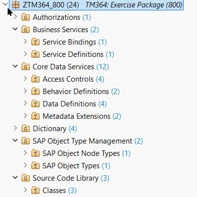 

## Exercise 2.2: Publish and Preview the Service
[^Top of page](#)

> Publish the service endpoint of your service binding `ZUI_TRIP_O4###` and preview the generated Fiori Elements app.

  
🔵 Click to expand!

-->

10. The activated service binding `ZUI_TRIP_O4###` is opened.    

    - ⚠️ Do **NOT press the Publish button** since this will lead to an error message.   

    - 🪄 Instead press **Ctrl+Alt+R** to open the start menu for **IDE actions**.   

    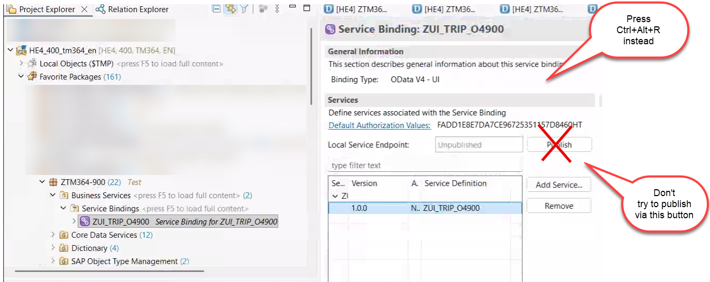   

    > If you press the **Publish** button nevertheless 😉, you will get several error messages. The service will not be published. Instead you have to publish it using a custom IDE action as described above.

11. Select the IDE action **Publish locally**

    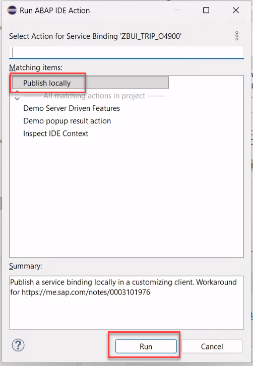 

12. Close the success message.
   
   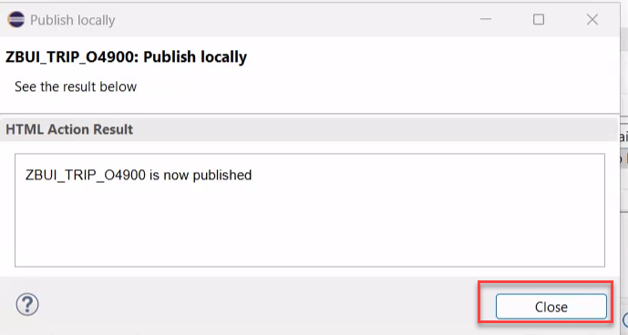 

13. Refresh the Service Binding. You should now see the entities of your generated RAP business object in the service binding editor.

> ### ℹ️ Workaround IDE action.   
> 
> In this system the role of the client 400 is set to customizing. According to [SAP Note 3101976](https://me.sap.com/notes/0003101976) this blocks the use of the publish locally button. Normally this would require using transaction `/IWFND/V4_ADMIN`. To avoid this, a custom IDE action has been created that allows publishing the service from within ADT
If the **IDE action** dialogue does not appear, please make sure, that you have selected your service binding, e.g. by double-clicking on it in the **Project Explorer**.  

## Exercise 2.2: Preview and Test the Service
[^Top of page](#)

> Since the service endpoint of your service binding `ZUI_TRIP_O4###` is now published you can preview the generated Fiori Elements app.

  
🔵 Click to expand!

1. Select the leading **`Trip`** entity and start the **Fiori Elements App Preview** by pressing the **Preview...** button or double-clicking it.  

   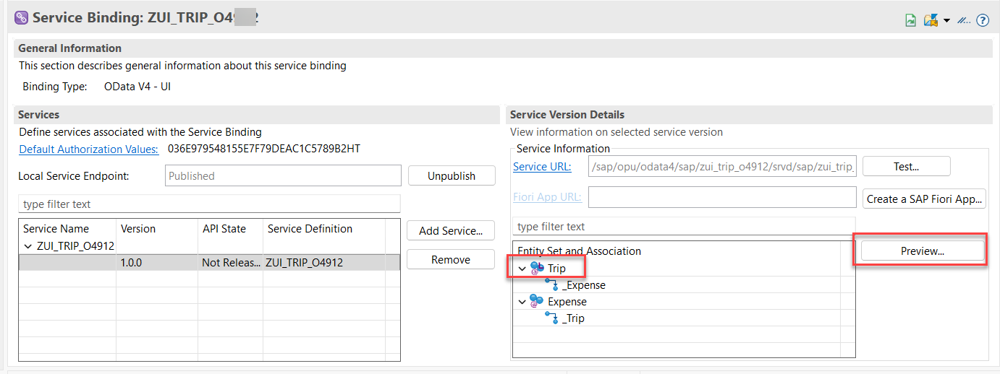 

2. Press **Go** to load the data in the app.

   > ℹ️ **The list should be empty at this point since no trip data has been created yet.**

   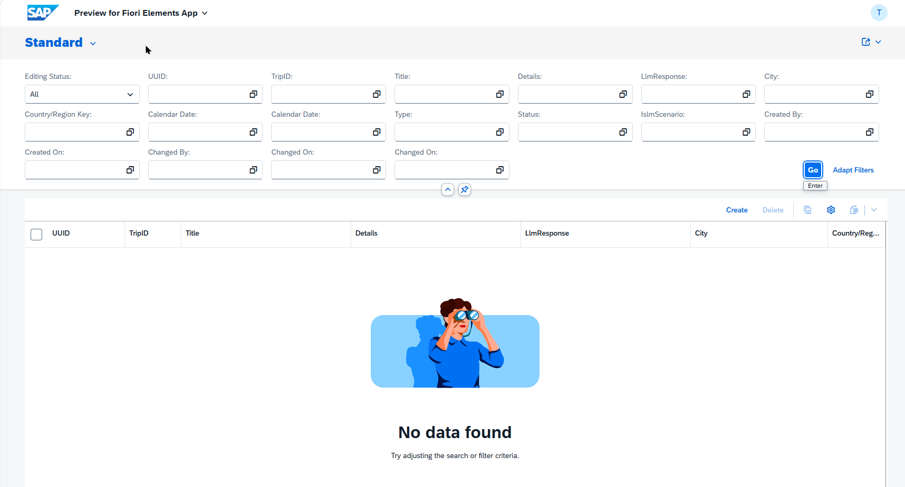 

## Summary & Next Exercise
[^Top of page](#)

Now that you've...
- generated a transactional UI service with two BO entities (Trip and Expense) using the RAP generator `OData UI Service from Scratch`,
- published the service endpoint and previewed the Fiori elements app

you can continue with the next exercise – **[Exercise 3: Basic Adaptations of the Generated UI Service](../ex03/README.md)**
