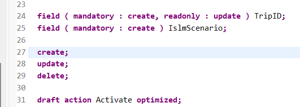
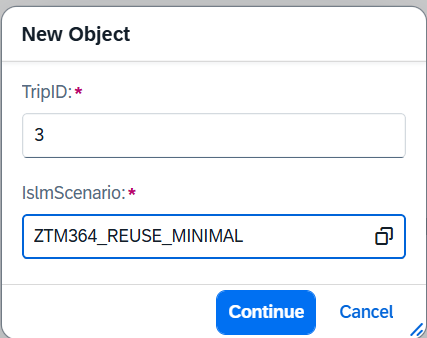
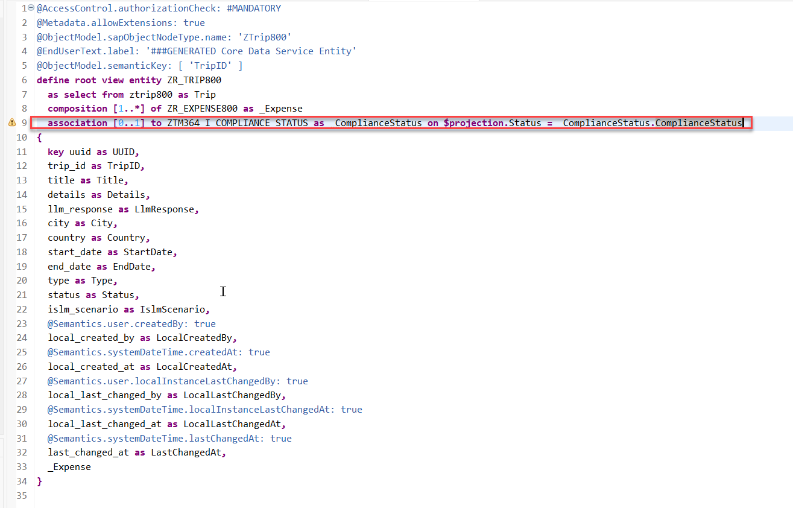
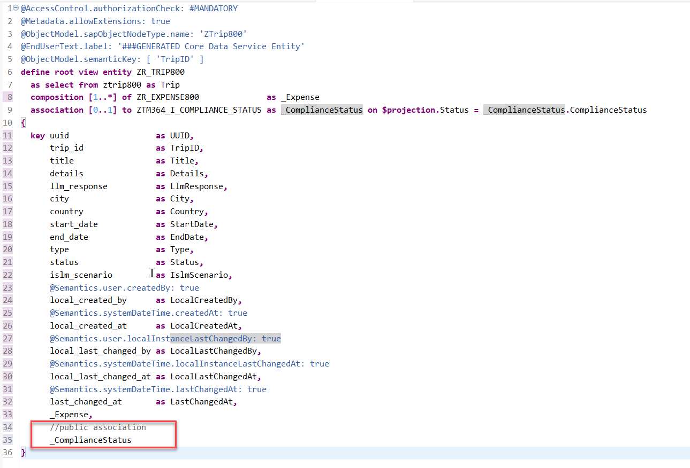
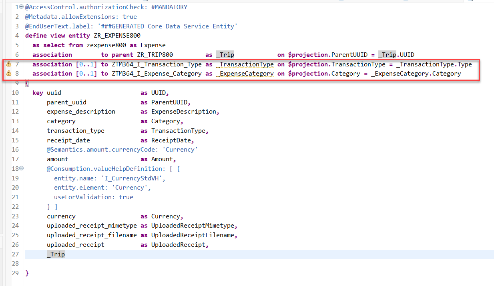

[Home - TM364](../../#exercises)

# Exercise 3: Basic Adaptations of the Generated UI Service

## Introduction

In the previous exercise, you've generated a RAP business object for storing _Trip_ and _Expense_ data  (see [Exercise 2](../ex02/README.md)).

Now enhance both metadata extension files to change the appearance of the generated Fiori elements based _Trip Management App_ with the following:   

- Value helps will be provided for certain fields
- The layout of some fields that can contain longer texts will be set to multiline
- Administrative and UUID based fields will be hidden

>⚠️⚠️ Caution:   
>Be sure to update both Metadata Extension files.

**Out of scope:**   
Due to time constraints in this hands-on we will not enhance the data model such, that we 
- add associations to the base (R-) layer that point to view entities that contain descriptions for categories and types. 
- add descriptions for the fields trip type, expense category and expense type in the projection layer that would make use of the aforementioned descriptions.   

<!--
>    
>The changes that would be needed have been added as an optional exercise though. 😉 
-->


# Exercises

- [3.1 - Adjust the Metadata Extension of the root entity - Trip](#exercise-31-adjust-the-metadata-extension-of-the-root-entity---trip)
- [3.2 - Adjust the Metadata Extension of the child entity - Expense](#exercise-32-adjust-the-metadata-extension-of-the-child-entity---expense)
- [3.3 - Make the fields TripID and ISLMScenario mandatory for new entities](#exercise-33-make-the-fields-tripid-and-islmscenario-mandatory-for-new-entities)
- [3.4 - Preview and test the enhanced Trip App](#exercise-34-preview-and-test-the-trip-app)
- [Summary & Next Exercise](#summary--next-exercise)

## Exercise 3.1: Adjust the Metadata Extension of the Root Entity - _Trip_
[^Top of page](#)

1. Open your metadata extension **`ZC_TRIP###`** and adjust the UI annotations to achieve the aforementioned changes on the Fiori elements based UI of the _Trip Management App_.

   For that, replace the generated source code of the metadata extension with the code provided in the code snippet below and replace all occurrences of the placeholder **`###`** with your group ID using **Ctrl+F**.

2. Save  and activate  the changes.

<details>
  <summary>🔵 Click to expand!</summary>
   
```
@Metadata.layer: #CORE
@UI.headerInfo.title.type: #STANDARD
@UI.headerInfo.title.value: 'TripID'
@UI.headerInfo.description.type: #STANDARD
@UI.headerInfo.description.value: 'TripID'
annotate view ZC_TRIP### with
{
  @UI.hidden: true
  UUID;

  @EndUserText.label: 'TripID'
  @UI.facet: [ {
    label: 'General Information',
    id: 'GeneralInfo',
    purpose: #STANDARD,
    position: 20 ,
    type: #IDENTIFICATION_REFERENCE
  },
  {
    label: 'Expense Items',
    id: 'ExpenseItems',
    purpose: #STANDARD,
    position: 21 ,
    type: #LINEITEM_REFERENCE,
    targetElement: '_Expense'
  } ]
  @UI.identification: [ {
    position: 20 ,
    label: 'TripID'
  } ]
  @UI.lineItem: [ {
    position: 20 ,
    label: 'TripID'
  } ]
  @UI.selectionField: [ {
    position: 20
  } ]
  TripID;

  @EndUserText.label: 'Title'
  @UI.identification: [ {
    position: 30 ,
    label: 'Title'
  } ]
  @UI.lineItem: [ {
    position: 30 ,
    label: 'Title'
  } ]
  Title;

  @EndUserText.label: 'Details'
  @UI.identification: [ {
    position: 40 ,
    label: 'Details'
  } ]
  @UI.lineItem: [ {
    position: 40 ,
    label: 'Details'
  } ]
  @UI.multiLineText: true
  Details;

  @EndUserText.label: 'LlmResponse'
  @UI.identification: [ {
    position: 50 ,
    label: 'LlmResponse'
  } ]
  @UI.lineItem: [ {
    position: 50 ,
    label: 'LlmResponse'
  } ]
  @UI.multiLineText: true
  LlmResponse;

  @EndUserText.label: 'City'
  @UI.identification: [ {
    position: 60 ,
    label: 'City'
  } ]
  @UI.lineItem: [ {
    position: 60 ,
    label: 'City'
  } ]
  @UI.selectionField: [ {
    position: 60
  } ]
  City;

  @UI.identification: [ {
    position: 70
  } ]
  @UI.lineItem: [ {
    position: 70
  } ]
  @UI.selectionField: [ {
    position: 70
  } ]
  @Consumption.valueHelpDefinition: [ {
  entity: {
    name: 'I_CountryVH',
    element: 'Country'
  }
  } ]
  Country;

  @UI.identification: [ {
    position: 80,
    label: 'StartDate'
  } ]
  @UI.lineItem: [ {
    position: 80,
    label: 'StartDate'
  } ]
  @UI.selectionField: [ {
    position: 80
  } ]
  StartDate;

  @UI.identification: [ {
    position: 90,
    label: 'EndDate'
  } ]
  @UI.lineItem: [ {
    position: 90,
    label: 'EndDate'
  } ]
  @UI.selectionField: [ {
    position: 90
  } ]
  EndDate;

  @EndUserText.label: 'Type'
  @UI.identification: [ {
    position: 100 ,
    label: 'Type'
  } ]
  @UI.lineItem: [ {
    position: 100 ,
    label: 'Type'
  } ]
  @UI.selectionField: [ {
    position: 100
  } ]
  Type;

  @EndUserText.label: 'Status'
  @UI.identification: [ {
    position: 110 ,
    label: 'Status'
  } ]
  @UI.lineItem: [ {
    position: 110 ,
    label: 'Status'
  } ]
  @UI.selectionField: [ {
    position: 110
  } ]
  @Consumption.valueHelpDefinition: [ {
  entity: {
  name: 'ZTM364_I_COMPLIANCE_STATUS',
  element: 'ComplianceStatus'
  }
  } ]
  Status;

  @EndUserText.label: 'IslmScenario'
  @UI.identification: [ {
    position: 120 ,
    label: 'IslmScenario'
  } ]
  @UI.lineItem: [ {
    position: 120 ,
    label: 'IslmScenario'
  } ]
  @UI.selectionField: [ {
    position: 120
  } ]
  @Consumption: {
  valueHelpDefinition: [ {
  entity.element: 'name',
  entity.name: 'ZTM364_I_5_ISLM_SCENARIOS_VH'
      } ]
      }
  IslmScenario;

  @UI.hidden: true
  LocalCreatedBy;

  @UI.hidden: true
  LocalCreatedAt;

  @UI.hidden: true
  LocalLastChangedBy;

  @UI.hidden: true
  LocalLastChangedAt;

  @UI.hidden: true
  LastChangedAt;

  @UI.hidden: true
  _BaseEntity;
}
```
   
</details>

## Exercise 3.2: Adjust the Metadata Extension of the Child Entity - _Expense_

[^Top of page](#)

1. Open your metadata extension **`ZC_EXPENSE###`** and adjust the UI annotations to achieve the aforementioned changes on the Fiori elements based UI of the _Trip Management App_.

   For that, replace the generated source code of the metadata extension with the code provided in the code snippet below and replace all occurrences of the placeholder **`###`** with your group ID using **Ctrl+F**.

2. Save  and activate  the changes.

<details>
  <summary>🔵 Click to expand!</summary>
   
```
@Metadata.layer: #CORE
@UI.headerInfo.title.type: #STANDARD
@UI.headerInfo.title.value: 'Category'
@UI.headerInfo.description.type: #STANDARD
@UI.headerInfo.description.value: 'Category'
annotate view ZC_EXPENSE### with
{

  @UI.facet: [ {
      label: 'General Information',
      id: 'GeneralInfo',
      purpose: #STANDARD,
      position: 10 ,
      type: #IDENTIFICATION_REFERENCE
    } ]

  @UI.hidden: true
  UUID;

  @UI.hidden: true
  ParentUUID;


  @EndUserText.label: 'ExpenseDescription'
  @UI.identification: [ {
    position: 30 ,
    label: 'ExpenseDescription'
  } ]
  @UI.lineItem: [ {
    position: 30 ,
    label: 'ExpenseDescription'
  } ]
  @UI.multiLineText: true
  ExpenseDescription;

  @EndUserText.label: 'Category'
  @UI.identification: [ {
    position: 40 ,
    label: 'Category'
  } ]
  @UI.lineItem: [ {
    position: 40 ,
    label: 'Category'
  } ]
  @Consumption: {
  valueHelpDefinition: [ {
  entity.element: 'Category',
  entity.name: 'ZTM364_I_Expense_Category'
  } ]
  }
  Category;

  @EndUserText.label: 'TransactionType'
  @UI.identification: [ {
    position: 50 ,
    label: 'TransactionType'
  } ]
  @UI.lineItem: [ {
    position: 50 ,
    label: 'TransactionType'
  } ]
  @Consumption: {
  valueHelpDefinition: [ {
  entity.element: 'Type',
  entity.name: 'ZTM364_I_Transaction_Type'

  } ]
  }
  TransactionType;

  @UI.identification: [ {
    position: 60
  } ]
  @UI.lineItem: [ {
    position: 60
  } ]
  ReceiptDate;

  @EndUserText.label: 'Amount'
  @UI.identification: [ {
    position: 70 ,
    label: 'Amount'
  } ]
  @UI.lineItem: [ {
    position: 70 ,
    label: 'Amount'
  } ]
  Amount;

  @EndUserText.label: 'UploadedReceiptMimetype'
  @UI.identification: [ {
    position: 80 ,
    label: 'UploadedReceiptMimetype'
  } ]
  @UI.lineItem: [ {
    position: 80 ,
    label: 'UploadedReceiptMimetype'
  } ]
  @UI.selectionField: [ {
    position: 80
  } ]
  UploadedReceiptMimetype;

  @EndUserText.label: 'UploadedReceiptFilename'
  @UI.identification: [ {
    position: 90 ,
    label: 'UploadedReceiptFilename'
  } ]
  @UI.lineItem: [ {
    position: 90 ,
    label: 'UploadedReceiptFilename'
  } ]
  @UI.selectionField: [ {
    position: 90
  } ]
  UploadedReceiptFilename;

  @EndUserText.label: 'UploadedReceipt'
  @UI.identification: [ {
    position: 100 ,
    label: 'UploadedReceipt'
  } ]
  @UI.lineItem: [ {
    position: 100 ,
    label: 'UploadedReceipt'
  } ]
  @UI.selectionField: [ {
    position: 100
  } ]
  UploadedReceipt;

  @UI.hidden: true
  _BaseEntity;
}

```
   
</details>


## Exercise 3.3: Make the Fields `TripID` and `IslmScenario` Mandatory for New Entities
[^Top of page](#)

1. Open your behavior definition **`ZR_TRIP###`** and set the fields fields `TripID` and `IslmScenario` to mandatory when creating a new trip.   

 <details>
  <summary>🔵 Click to expand!</summary>

Go to the behavior definiton of the _Trip_ BO entity **`ZR_TRIP###`** and insert the following statement right before the statement **`create;`** as shown on the screenshot below: 

   ```ABAP 
   field ( mandatory : create, readonly : update ) TripID;
   field ( mandatory : create ) IslmScenario;
   ```

The source code of the behavior definition should then look like this: 
  
    
   
   **Short explanation**:  
   The statements specifiy that a user has to enter 
   - a valid numeric value for `TripID` (e.g. 1, 2, 3, ...) and
   - has to select one value for the `IslmScenario`  
   when the user presses the create button on the list page.
   The `TripID` can't be changed afterwards. 
   
2. Save  and activate  the changes.   

3. As a result, the user will see the following dialog when creating a new _Trip_ instance.  

   


</details>


## Exercise 3.4: Preview and Test the _Trip App_
[^Top of page](#)

Test the enhanced SAP Fiori elements application.

 <details>
  <summary>🔵 Click to expand!</summary>

 1. Open your service binding  **`ZUI_TRIP_O4###`** and double-click the _**Trip**_ entity set to open the SAP Fiori elements preview.
 
    
 2. Create a new _Trip_ entity.   

</details>


<!--  

In this exercise, you will enhance the base BO data model as well as the projected BO data model and its metadata extension, and test the enhanced Fiori elements _Trip_ app. These enhancements will include:   
- Adding `ObjectModel.text.element[ <field_name> ]` annotations that will display descriptive texts alongside the key values that are stored in the business object (e.g. "CM (customer meeting)" ) 
- Adding value helps for some fields
- Enable OData Streams so that we can upload receipts


 
## Add Associations to the Base Root View `ZR_TRIP###`

1. Define a new associations **`_ComplianceStatus`**.
 
   Open your data definition **`ZR_TRIP###`** and format the source code with the **ABAP Formatter** (aka _Pretty Printer_) by pressing **Shift+F1**.  
 
   Insert the following code snippet after the **`composition [1..*]`** statement as shown on the screenshot below and format the source code (**Shift+F1**).            
     
   ```ABAP
    association [0..1] to ZTM364_I_COMPLIANCE_STATUS as _ComplianceStatus on $projection.Status = _ComplianceStatus.ComplianceStatus
   ```
    
   Your source code should look like this:
    
               
    
2. Expose the defined association **`_ComplianceStatus`** in the selection list.   
  
   For that, insert the code snippet provided below in the selection list between the curly brackets (`{...}`) as shown on the screenshot and format the source code (**Shift+F1**).

   ```ABAP
     , 
     //public association
     _ComplianceStatus
   ```
      
     
      
   3. Save  (**Ctrl+S**) and activate  (**Ctrl+F3**) the changes.

## Add Associations to the Base Child View `ZR_EXPENSE###`

1. Open your data definition **`ZR_EXPENSE###`** and format the source code with the **ABAP Formatter** (aka _Pretty Printer_) by pressing **Shift+F1**.  
 
   Insert the following code snippet after the **`association to parent`** statement as shown on the screenshot below and format the source code (**Shift+F1**).            
     
   ```ABAP
      association [0..1] to ZTM364_I_Transaction_Type as _TransactionType on $projection.TransactionType = _TransactionType.Type
      association [0..1] to ZTM364_I_Expense_Category as _ExpenseCategory on $projection.Category = _ExpenseCategory.Category
   ```
    
   Your source code should look like this:
    
               
    
2. Expose the defined associations **`_TransactionType`** and **`_ExpenseCategory`**in the selection list.   
  
   For that, insert the code snippet provided below in the selection list between the curly brackets (`{...}`) as shown on the screenshot and format the source code (**Shift+F1**).

   ```ABAP
      //public assocations
      ,
      _TransactionType,
      _ExpenseCategory
   ```
      
     
      
   3. Save  (**Ctrl+S**) and activate  (**Ctrl+F3**) the changes.

   
## Add Fields and Annotations to the Root Projection View `ZC_TRIP###`

## Add Fields and Annotations to the Child Projection View `ZC_EXPENSE###`

-->


## Summary & Next Exercise
[^Top of page](#)

Now that you've...
- added some value helps
- enabled multiline edit for some text fields 
- made two fields mandatory for new trip entities

you can continue with the next exercise – **[Exercise 4: Add a determination for trip classification](../ex04/README.md)**

---
