[Home - TM364](../../#exercises)

# Exercise 4: Use the ABAP AI SDK in a Determination to Set the Category of a Trip

## Introduction

In **[Exercise 1](../ex01/README.md)**, you've defined and implemented the class `ztm364_cl_islm_trip_type_###` that leverages the _ABAP AI SDK_ to determine the category of a trip based on its title and/or a detailed description.

You then generated a RAP business object for trip management, the _Trip App_, that allows you to create trips with a title, description and other trip details.

In the present exercise, you will define and implement a determination, `setTripCategory`, which will be used to set the value for the category of _Trip_ entity instance once the user saves a trip.  

The code in the behavior implementation class will call your class `ztm364_cl_islm_trip_type_###`.

You will use the Entity Manipulation Language (EML) to implement the transactional behavior of the _Trip_ business object. 


## Exercises

- [4.1 - Define the Determination `setTripCategory`](#exercise-41-define-the-determination-setstatustoopen)
- [4.2 - Implement the Determination `setTripCategory`](#exercise-42-implement-the-determination-setstatustoopen)
- [4.3 - (optional) - Define the validation `checkIslmScenario`](#exercise-43-optional-define-the-validation-checkislmscenario)
- [4.4 - (optional) Implement the validation checkIslmScenario using Joule 💎](#exercise-44-optional-implement-the-validation-checkislmscenario-using-joule-)
- [4.5 - Preview and Test the Enhanced Trip Management App](#exercise-45-preview-and-test-the-enhanced-travel-app)
- [4.6 - Try out different ISLM scenarios](#exercise-46-use-different-islm-scenarios)
- [Summary & Next Exercise](#summary--next-exercise)

> **Reminder**: Do not forget to replace the suffix placeholder **`###`** with your chosen or assigned group ID in the exercise steps below. 

### About Determinations  
> A determination is an optional part of the business object behavior that modifies instances of business objects based on trigger conditions. A determination is implicitly invoked by the RAP framework if the trigger condition of the determination is fulfilled. Trigger conditions can be modify operations and modified fields.   
>  
> **Further reading**: [Determinations](https://help.sap.com/docs/abap-cloud/abap-rap/determinations?locale=en-US&ai=true)

### About Entity Manipulation Language (EML)
> The Entity Manipulation Language (EML) is an extension of the ABAP language which offers an API-based access to RAP business objects. EML is used to implement the transactional behavior of RAP BOs and also access existing RAP BOs from outside the RAP context.   
> 
> PS: Some EML statements can be used in the so-called local mode - by using the [addition **`IN LOCAL MODE`**](https://help.sap.com/doc/abapdocu_cp_index_htm/CLOUD/en-US/index.htm?file=abapin_local_mode.htm) - to exclude feature controls and authorization checks. This addition can only be used in the behavior implementation (aka behavior pool) of a particular RAP BO when accessing its own instances, i. e., not for accessing instances of other RAP BOs.
>
> The EML reference documentation is provided in the ABAP Keyword Documentation.   
> You can use the classic **F1 Help** to get detailed information on each statement by pressing **F1** in the ABAP editors. 
>
> **Further reading**: [Entity Manipulation Language (EML)](https://help.sap.com/docs/abap-cloud/abap-rap/entity-manipulation-language-eml?locale=en-US) | [ABAP for RAP Business Objects](https://help.sap.com/docs/abap-cloud/abap-keywords/abap-for-rap-business-objects?locale=en-US&ai=true) 


## Exercise 4.1: Define the Determination `setTripCategory`
[^Top of page](#)

> Define the determination **`setTripCategory`** in the behavior definition of the _Trip_ entity. This determination will be used to set the value of the field `Type` to one of the available trip types when the _Trip_ instance is saved.   
>
> If possible it will also retrieve additional trip details, such as begin and end date, the name of the destination city and its country code.

The determination will in addition store a detailed response from the large language model (LLM) so that it is easier for you to compare the effect when using different ISLM scenarios that differ in the amount of features that are being leveraged from the _Orchestration Service_ of _SAP AI Core_.

 <details>
  <summary>🔵 Click to expand!</summary>

1. Go to the behavior definiton of the _Trip_ BO entity **`ZR_TRIP###`** and insert the following statement before the statement **`create;`** as shown on the screenshot below: 

   ```ABAP 
     field ( readonly ) LlmResponse;
     determination setTripCategory on save { field Title; field Details; }
   ```
  
  
   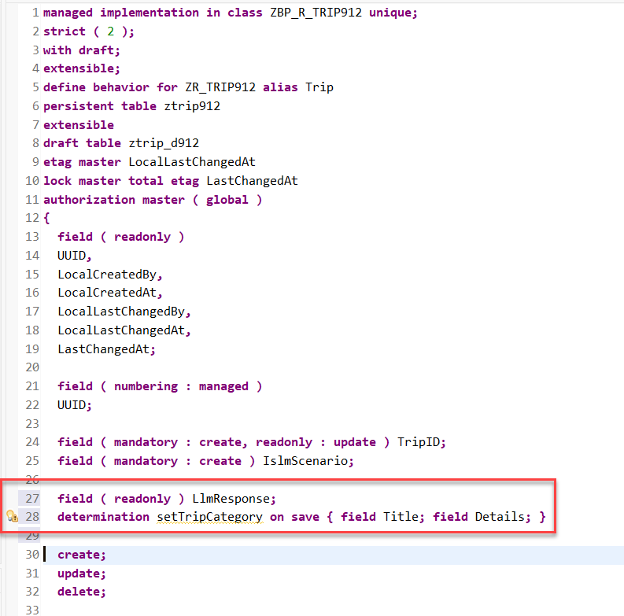 
   
   **Short explanation**:  
   The statement specifies the name of the new determination `setTripCategory`, and `on save` as the determination time when creating new _trip_ instances.
   As trigger conditions, the field names `Title`  and `Details` are specified. This means that the determination is only run when one of the fields, or both have been updated.
   
2. Save  and activate  the changes.   

3. Now, declare the required method in the behavior implementation class with ADT Quick Fix.
  
   Set the cursor on the determination name **`setTripCategory`** and press **Ctrl+1** to open the **Quick Assist** view and select the entry _`Add method for determination settripcategory of entity zr_trip### ...`_ in the view.
   
   As a result, the `FOR DETERMINE` method **`setTripCategory`** will be added to the local handler class **`lhc_zr_trip###`** of the behavior pool of the _Trip_ BO entity **`ZBP_R_TRIP###`**.
         

   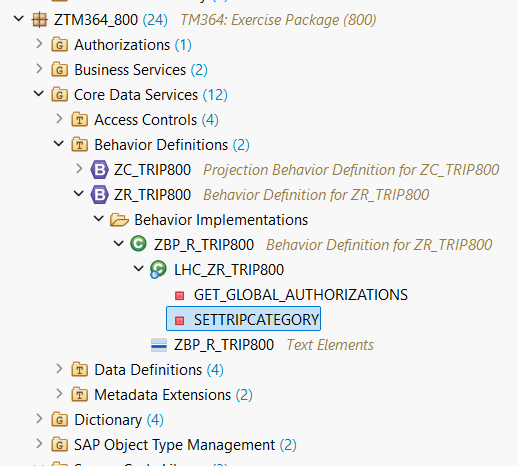  
   
You are through with the definition of the determination.

</details>


## Exercise 4.2: Implement the Determination `setTripCategory` 
[^Top of page](#)

You will now implement the logic of the defined determination in the behavior pool. You can find the place where the business logic is being implemented also via the project explorer (see screenshot above).

 <details>
  <summary>🔵 Click to expand!</summary>

1. First check the interface of the method **`setTripCategory`** in the declaration part of the local handler class `lhc_zrtrip###`. 

   For that, set the cursor on the method name, **`setTripCategory`**, press **F2** to open the **ABAP Element Info** view, and examine the full method interface. 
   
   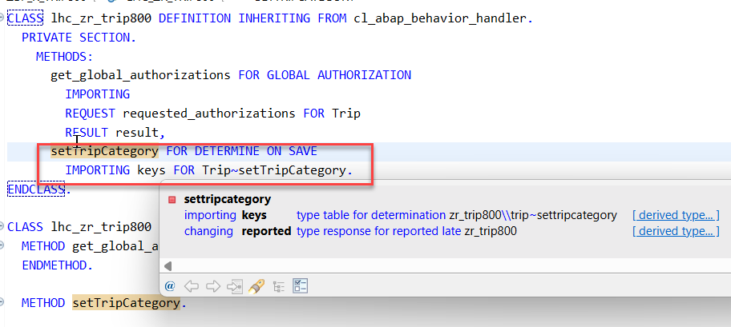  
   
   **Short explanation**:  
   - The addition **`FOR DETERMINE`** indicates that the method provides the implementation of a determination and the addition **`ON SAVE`** indicates the specified trigger time.
   - `IMPORTING`parameter **`keys`** - an internal table containing the keys of the instances the determination will be executed on 
   all entities for which keys must be assigned    
   - Implicit **`CHANGING`** parameter **`reported`** - used to return messages in case of failure   
         
    Now go ahead and implement the method in the implementation part of the local handler class.

2. Now implement the method **`setTripCategory`** in the implementation part of the class.
   
   The logic consists of the following steps:    
     1. Read the trip instance(s) of the transferred keys (**`keys`**) using the EML statement **`READ ENTITIES`**   
     2. The addition **`IN LOCAL MODE`** is used to exclude feature controls and authorization checks   
     3. Remove all _Trip_ instances where no ISLM scenario is provided since this would cause a dump in 2025. (fixed for upcoming releases)    
     4. Loop over the remaining entries and call the `get_trip_type()` method for each of them.
     5. The results will be stored in a internal table `update` that is of type `TABLE FOR UPDATE zr_trip###\\Trip`.
     6. Perform an EML statement **`MODIFY ENTITIES`** with this data  
     7. Set the changing parameter **`reported`** in case some messages need to be passed on. 

   Insert the following code snippet in the method and replace all occurrences of the placeholder `###` with your group ID.   
   You can use the **F1 help** to get detailed information on each EML statement.
 
   Format your source code with the **ABAP Pretty Printer** (**Shift+F1**).
   
   ```ABAP
  
    DATA update TYPE TABLE FOR UPDATE zr_trip###\\Trip.
    DATA update_line TYPE STRUCTURE FOR UPDATE zr_trip###\\Trip .

    DATA recommendation_api TYPE REF TO ztm364_cl_islm_trip_type_###.

    recommendation_api = NEW #(  ).

    READ ENTITIES OF zr_trip### IN LOCAL MODE
            ENTITY trip ALL FIELDS WITH CORRESPONDING #( keys )
            RESULT DATA(trips).

    DELETE trips WHERE IslmScenario IS INITIAL.
    CHECK trips IS NOT INITIAL.

    LOOP AT trips INTO DATA(trip).

      recommendation_api->get_trip_type(
        EXPORTING
          i_title         = CONV #( trip-Title )
          i_details       = trip-Details
          i_islm_scenario = trip-IslmScenario
        IMPORTING
          e_response      = DATA(response)
          e_category      = DATA(category)
          e_enddate       = DATA(enddate)
          e_startdate     = DATA(startdate)
          e_country       = DATA(country)
          e_city          = DATA(city)
      ).

      update_line-%tky = trip-%tky.
      update_line-Type = category.
      update_line-LlmResponse = response.
      update_line-EndDate = enddate.
      update_line-StartDate = startdate.
      update_line-City = city.
      update_line-Country = country.

      APPEND update_line TO update.

    ENDLOOP.

    MODIFY ENTITIES OF zr_trip### IN LOCAL MODE
      ENTITY Trip
      UPDATE FIELDS ( Type LlmResponse StartDate EndDate City Country )
      WITH  update
      REPORTED DATA(update_reported) .

    "Set the changing parameter
    reported = CORRESPONDING #( DEEP update_reported ).

   ```  

<!--
*      APPEND VALUE #(
*        %tky        = trip-%tky
*        %state_area = 'SETTRIPCATEGORY'
*      ) TO reported-trip.
*
*      IF trip-IslmScenario IS INITIAL.
*        trip-IslmScenario = 'ZTM364_REUSE_MINIMAL'.
*        APPEND VALUE #(
*            %tky        = trip-%tky
*            %state_area = 'SETTRIPCATEGORY'
*            %msg        = new_message_with_text(
*            severity = if_abap_behv_message=>severity-warning
*            text     = 'No ISLM scenario selected' )
*         ) TO reported-trip.
*        RETURN.
*      ENDIF.
-->
  
   Your source code should look like this:
   
   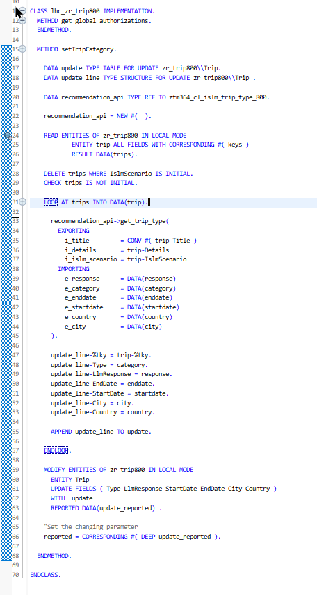 

4. Save  and activate  the changes. 

</details>

> Exercise 4.3 and 4.4 are optional. They are recommended since the determination needs a name of an ISLM scenario. Currently the implementation of the determination does nothing when no ISLM scenario is provided, which may confuse end users.

## Exercise 4.3: (Optional) Define the Validation `checkIslmScenario`

Define the validation `checkIslmScenario` in the behavior definition of the _Trip_ entity. This validation will be used to make sure that a valid ISLM scenario has been selected and that the field is not empty.

<details>
  <summary>🔵 Click to expand!</summary>

1. Go to the behavior definiton of the _Trip_ BO entity **`ZR_TRIP###`** and insert the following statement before the statement **`create;`** as shown on the screenshot below: 

   ```ABAP    
   validation checkIslmScenario on save { field IslmScenario; }
   ```

   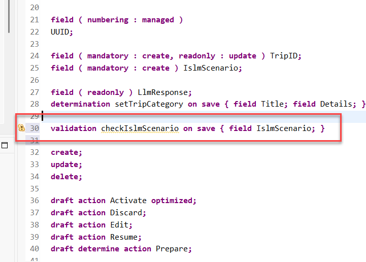 

2. Save  and activate  the changes.   


3. You get two warnings:
   - The first warning is about a missing implementation
   - The second warning is about that the validation has not been added yet to any determine actions. Not event to the draft action prepare.
   
   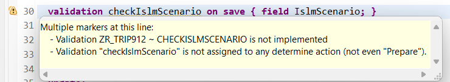 

   We start with the warning that the validation has not been added yet to any determine action because this warning can be solved by changing the `Prepare` statement in the BDEF.   
   
   Replace the statement 
   
   ```
   draft determine action Prepare;
   ``` 
   
   with the following statement:

   ```
   draft determine action Prepare
   {
      validation checkIslmScenario;
   }
   ```

3. There is still a warning that the method `checkIslmScenario` has not been implemented yet.   

   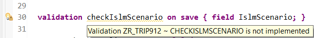

   Now, declare the required method in behavior implementation class with the ADT Quick Fix.
  
   Set the cursor on the validation name **`checkIslmScenario`** and press **Ctrl+1** to open the **Quick Assist** view and double click on the entry _`Add method for validation checkIslmScenario of entity zr_trip### ...`_ in the view.

   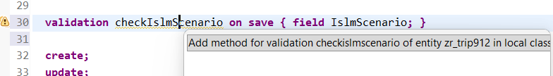 
   
   As s result, the `FOR VALIDATION` method **`checkIslmScenario`** will be added to the local handler class **`lhc_zr_trip###`** of the behavior pool of the _Trip_ BO entity **`ZBP_R_TRIP###`**.
         


</details>

## Exercise 4.4: (Optional) Implement the Validation `checkIslmScenario` Using Joule 💎
[^Top of page](#)

You will now implement the logic of the defined validation in the behavior pool. 
<details>
  <summary>🔵 Click to expand!</summary>

1. Place the cursor just behind the dot `.` that ends the statement `METHOD checkIslmScenario.` 
2. Press **Ctrl+1** and select `Predict RAP business logic`.
   
   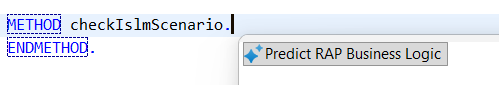  

3. Enter the following prompt and send the message. 

   ```
   /raplogic Check whether the field islmscenario is not initial.
   ```   

   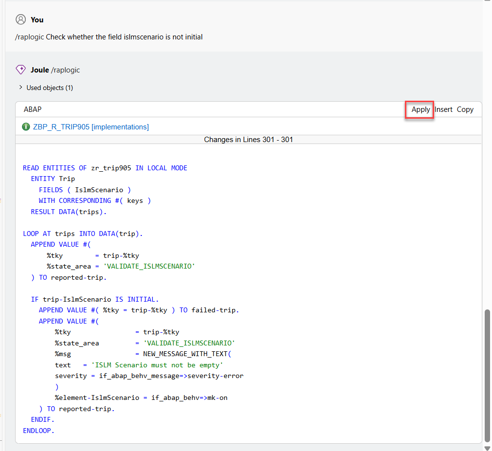

   Once you get a proposal like this, press **apply**. 

4. In the **Apply Changes** dialog press **Finish** 

   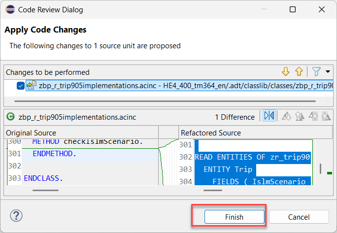 

5. Save  and activate  the changes.

</details>


## Exercise 4.5: Preview and Test the Enhanced Travel App
[^Top of page](#)

> You can now preview and test the changes by creating a new travel instance in the Travel app.

 <details>
  <summary>🔵 Click to expand!</summary>

1. Refresh your application in the browser using **F5** if the browser is still open   
   or go to your service binding **`ZUI_TRIP_O4###`** and start the Fiori elements App preview for the **`Trip`** entity set.

2. Create a new _Trip_ instance and provide a description and some trip details. 

   We have provided a sample for a trip title and trip details below.
   
   Be sure to have selected a valid ISLM scenario, e.g. **`ZTM364_REUSE_MINIMAL`** using the value help.

  
3. Enter Meeting title 

   ```
   Meeting with Customer AG
   ```
4. Enter meeting details.

   ```
   Subject: Statusmeeting : RAP implementation at Customer AG 

   Location:    Dallas, Texas

   Start:   Mon 12/10/2026 12:30
   End: Mon 14/10/2026 14:00

   Recurrence:  (none)

   Meeting Status:  Meeting organizer

   Organizer:   Doe, John
   Required Attendees:  Doe, John; Major, Mary
   Resources:   MR WDF77 H3.03 (12) (Video)

   Categories:  SAP internal event

   Topics: 
   - Discuss prices for next offer
   - List of customer tickets
   - Next steps
   ```
5. Select `ZTM364_REUSE_MINIMAL` as the ISLM Scenario using the value help.

6. Your inputs should look as follows. Now press **Create**.

   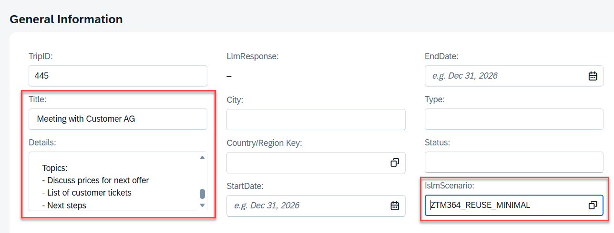 

7. After the LLM has succeeded, the trip type and summary fields should contain values

7. You should receive a result like the following:   

   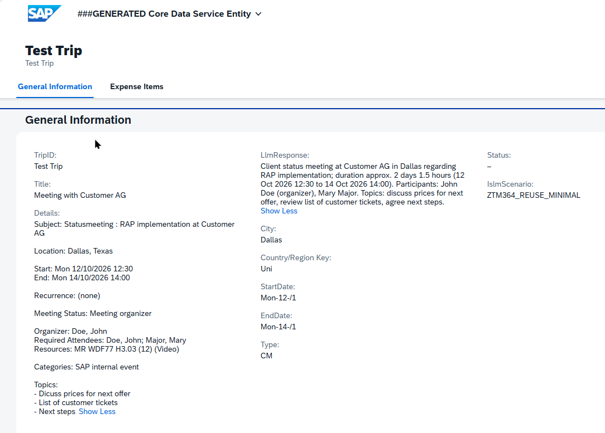

</details>

## Exercise 4.6: Use Different ISLM Scenarios

You can rerun your tests with the ISLM scenarios that make use of 

- masking
- translation

> ⚠️ Please note:
> The ISLM scenario that is using grounding contains a travel policy as a grounding document and will be used in a later exercise to check the trip after expenses have been added.

## Summary & Next Exercise
[^Top of page](#)

Now that you've...
- added a determination for the trip category and other trip details

you can continue with the next exercise – **[Exercise 5: Add the upload capability for receipts](../ex05/README.md)**

---
