[Home - TM364](../../#exercises)

# Exercise 5: Enable the Upload and Download of Files in Your Fiori Elements Application
[^Top of page](#)

> Adjust the data model of the base RAP BO to enable users to upload and download images of receipts when using your _Trip App_. This is achieved by setting appropriate annotations `@Semantics.largeObject` and `@Semantics.mimeType` for the field on the projection layer that contains the binary data and its _mimeType_.  
> 
> The only thing you will have to do in the RAP BO, is to specify the appropriate semantics annotations for the relevant fields: `UploadedReceipt`, `UploadedReceiptMimetype`, and `UploadedReceiptFilename`. 
> You will usually also have to adjust the UI semantics in the CDS metadata Extension for the appearance in the _Trip App_ if you want to display the uploaded picture on the object page header. 

> The official name used in the documentation is handling of large objects (BLOBs, aka OData stream) in your Fiori elements app. 
> ℹ **Further reading**: [Working with Large Objects](https://help.sap.com/docs/abap-cloud/abap-rap/working-with-large-objects?locale=en-US)  

## Exercises

- [5.1 - Adapt the base view ZR_Expense###](#exercise-51-adapt-the-base-view-zr_expense)
- [5.2 - Adapt the projection view ZC_Expense###](#exercise-52-change-the-projection-view-zc_expense)
- [5.3 - Change the datatype of the field `uploaded_receipt` in table `ZEXPENSE###`](#exercise-53--change-the-datatype-of-the-field-uploaded_receipt-in-table-zexpense)
- [5.4 - Re-create the draft table `ZEXPENSE_D###`](#exercise-54-re-create-the-draft-table-zexpense_d)
- [5.5 - Test your application](#exercise-55-test-your-application)
- [Summary & Next Exercise](#summary--next-exercise)

## Exercise 5.1: Adapt the Base View **`ZR_Expense###`**

 1. Open the CDS data definition of the child entity _Expense_ **`ZR_Expense###`** and have a look at following elements in the _select_ list:

      - **`UploadedReceipt`** - It is used to store the BLOB (aka stream). It must be annotated appropriately using the CDS annotation `@Semantics.largeObject`. It is technically bound to the field `MimeType` and is has to be of type `rawstring(0)`.  
      - **`UploadedReceiptMimetype`** - It is used to indicate the content type of the uploaded receipt. It must be tagged appropriately using the CDS annotation `@Semantics.mimeType`.
      - **`UploadedReceiptFilename`** - It is used to store the file name of the BLOB (stream). This is optional. No specific annotation is needed for this element. 

 2. Use the code snippets provided below and annotate the elements.

     - For element **`UploadedReceiptMimetype`**: 
     ```ABAP
        @Semantics.mimeType: true
     ```

     - For element **`UploadedReceipt`**:
     ```ABAP
       @Semantics.largeObject: { mimeType: 'UploadedReceiptMimetype',   //case-sensitive
                                 fileName: 'UploadedReceiptFilename',   //case-sensitive
                                 acceptableMimeTypes: ['image/png', 'image/jpeg', 'image/webp'],
                                 contentDispositionPreference: #ATTACHMENT }
     ``` 

 3. Your code should now look as follows

    ```
      @Semantics.mimeType: true
      uploaded_receipt_mimetype as UploadedReceiptMimetype,
      uploaded_receipt_filename as UploadedReceiptFilename,
      @Semantics.largeObject: { mimeType: 'UploadedReceiptMimetype',   //case-sensitive
                          fileName: 'UploadedReceiptFilename',   //case-sensitive
                          acceptableMimeTypes: ['image/png', 'image/jpeg', 'image/webp'],
                          contentDispositionPreference: #ATTACHMENT }
      uploaded_receipt          as UploadedReceipt,
    
    ```   


    **Short explanation**: The attributes of the annotation `@Semantics.largeObject`
     - `mimeType`: It indicates the name of the field containing the type of a MIME object. ⚠ The value is case sensitive.
     - `fileName`: It indicates the name of the field containing the file name of a MIME object. ⚠ The value is case sensitive.
     - `acceptableMimeTypes`: It provides the list of acceptable MIME types for the related stream property to restrict or verify the user entry accordingly. 
 If any subtype is accepted, this can be indicated by `*`.
     - `contentDispositionPreference`: It indicates whether the content is expected to be displayed inline in the browser, i.e., as a Web page or as part of a Web page, or as an attachment, i.e., downloaded and saved locally.

 3. Save  (**Ctrl+S**) and activate  (**Ctrl+F3**) the changes.


## Exercise 5.2: Change the Projection View **`ZC_Expense###`**

 1. Now adapt the projection view **`ZC_Expense###`**.  

    Here you have to comment out the annotation **`@Metadata.ignorePropagatedAnnotations: true`** because otherwise the anntoations set on the base layer will not become active in your SAP Fiori Elements UI.
  
    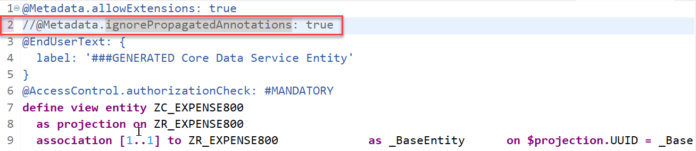  

 2. Save  (**Ctrl+S**) and activate  (**Ctrl+F3**) the changes.


## Exercise 5.3:  Change the Datatype of the Field uploaded_receipt in Table `zexpense###`

Since the OData UI Service from Scratch generator does not support the use of fields of type `rawstring(0)` which is required to store the binary data of pictures, we used the datatype `string(0)` for the field uploaded_receipt in our template structure.

This way, the field was added to all relevant repository objects (base view, projection view, metadata extension).

Before activating the OData Stream feature we therefore need to change the datatype of the fields in the active and the draft table that store the expense data.

1. Navigate to the Database Table `zexpense###` in the project explorer.

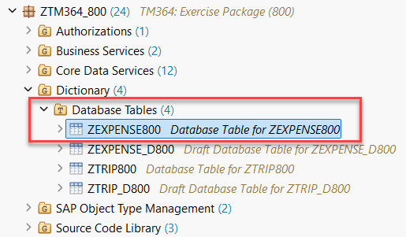  

2. Open the table `zexpense###` in the editor.     

3. Change the data type of the field `uploaded_receipt` from `abap.string(0);` to `abap.rawstring(0);`

   ```
   uploaded_receipt          : abap.rawstring(0);
   ```
   
4. Your coding should now look like as follows

   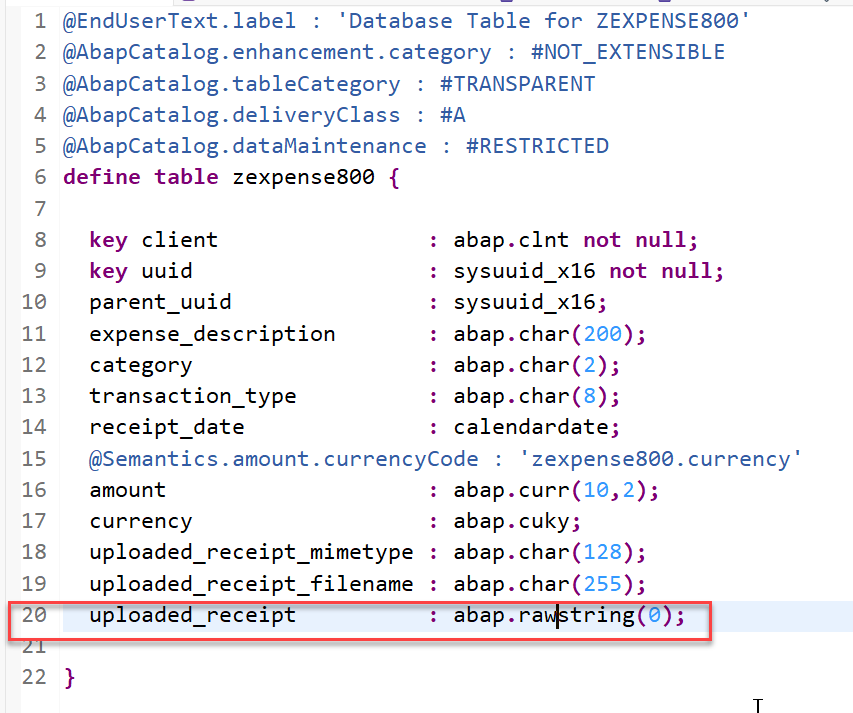  

5. Save  (**Ctrl+S**) and activate  (**Ctrl+F3**) the changes.

### Potential error when database table already contains data

When the table already contains data, the user will get the error message `Structure change at field level`.

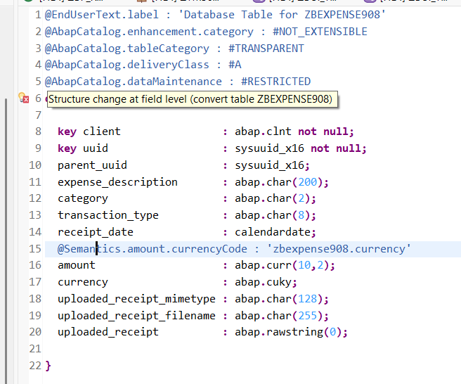 

1. This can be resolved by selecting the table and pressing **Ctrl+1** to get a quick fix. 
   
   a. First try out the option **Adjust and activate database table, convert data**  
   b. Only if this does not work try out the option **Adjust and activate table, delete data** ⚠️ Potential loss of data ! 
   
   When developing a productive app only option a) would be chosen. Otherwise you would lose data. 
   But if option a) does not work in this hands-on, you can also use option b), which deletes the data on the database table.

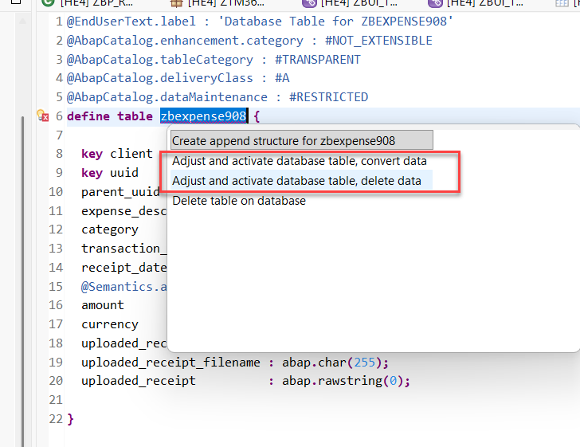 

## Exercise 5.4: Re-Create the Draft Table `zexpense_d###`

1. Open behavior definition  `ZR_TRIP###`.

2. Press (Ctrl+F2) or choose the blue check mark _Check ABAP Development Object_.  

   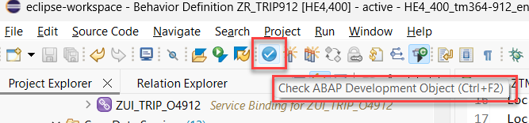 

2. Check the warning / error message that the draft table in the _Expense_ entity is not a suitable draft persistence for `ZR_EXPENSE###`.

   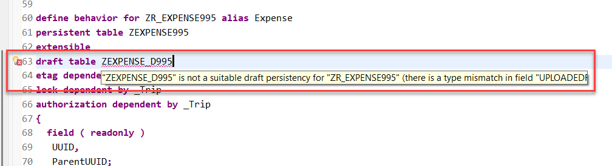 

3. Use the quick-fix (press Ctrl+1) to re-generate the draft table `zexpense_d###`.

   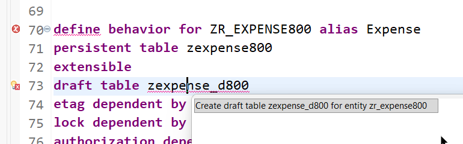 

4. Save  (**Ctrl+S**) and activate  (**Ctrl+F3**) the changes.

5. The new draft table should look as follows:

    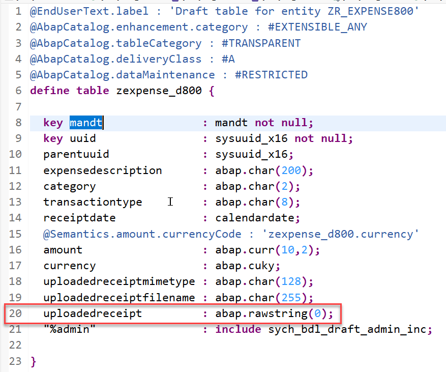 
   
   
## Exercise 5.5: Test Your Application

> You can now preview and test the changes by creating a new trip instance in the _Trip App_.

1. Refresh your application in the browser using **F5** if the browser is still open or go to your service binding **`ZUI_TRIP_O4###`** and start the Fiori elements App preview for the **`Trip`** entity set.

2. Create a new _Trip_ instance and provide a description and some trip details. 

> For your convienience we have provided some sample data for _hotel receipts_ and _taxi receipts_ to provide samles for expenses. The naming e.g. **EU10** indicates data sets for one trip.

> The receipts can be [downloaded from here](../../receipts/) (Tip: open in a new tab or browser window).


3. Click on **Create** on the **Expense** tab to create a new expense.

   Here you will see a new button that allows you to start the upload of a picture from your frontend PC.

  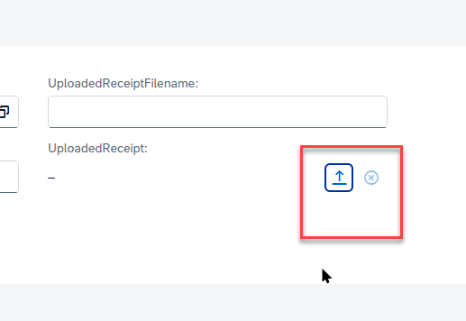  

  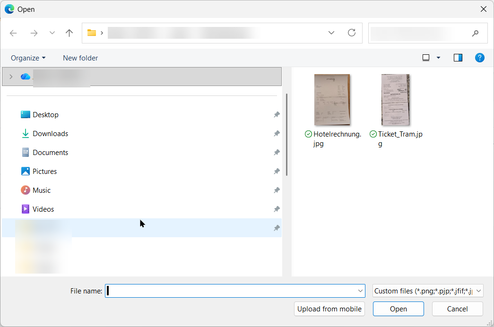  

4. As a result, the Expense entry contains a link that would allow you to display the picture in a separate tab.

   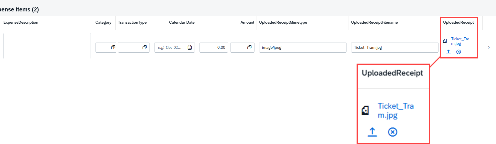  


## Summary & Next Exercise
[^Top of page](#)

Now that you've...
- added the annotations that allow you to upload receipts to your expenses 
- changed the type of the field uploaded_receipt in the table `zexpense### ` and the draft table `zexpense_d###`

you can continue with the next exercise – **[Exercise 6: Add a determination to extract data from receipts](../ex06/README.md)**

---
