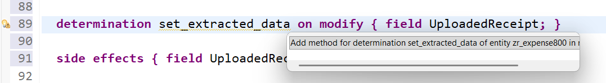
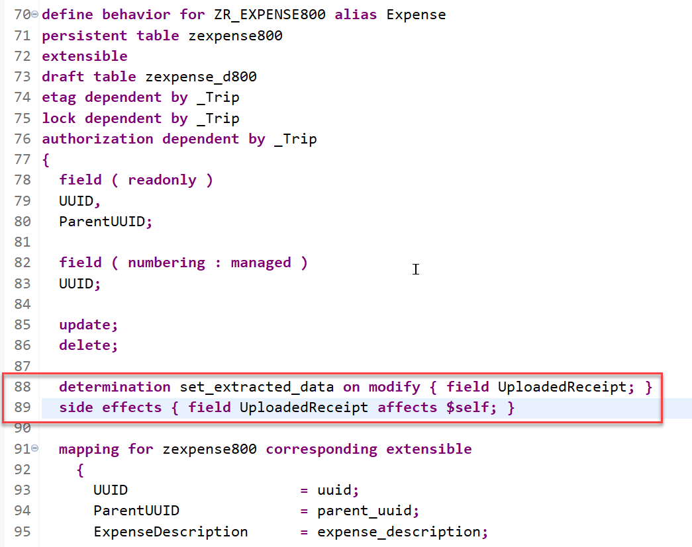
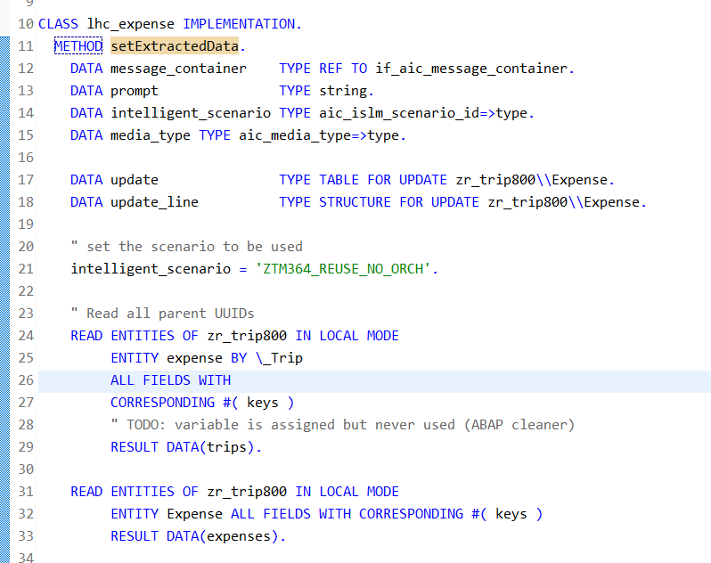
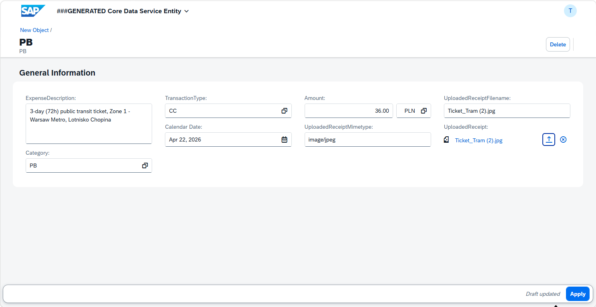

[Home - TM364](../../#exercises)

# Exercise 6: Add a Determination to Extract Data from Receipts

## Introduction

In **[Exercise 4](../ex04/README.md)**, you've defined and implemented a determination to determine the category of a trip based on its title and/or a detailed description.

In the present exercise, you will define and implement a determination, `setExtractedData`, which will be used to retrieve data from the uploaded receipts and set the values the expense description, the amount, the transaction type and the type of expense. 

You will again use the Entity Manipulation Language (EML) to implement the transactional behavior of the _Trip_ business object. 

> Use of **Completion API** instead of the **Orchestration Service API** 
> Since the ABAP AI SDK for the orchestration service integration does not yet support the use of binary data, we will have to use the older so called **completion API**. Since the use of the orchestration service is the way to go in the long run, you should check when performing your own implementations whether the support of binary data has meanwhile been added also to the orchestration service API.

## Exercises

- [6.1 - Define the Determination `setExtractedData`](#exercise-61-define-the-determination-setextracteddata)
- [6.2 - Implement the Determination `setExtractedData`](#exercise-62-implement-the-determination-setextracteddata)
- [6.3 - Preview and Test the Enhanced Trip Management App](#exercise-63-preview-and-test-the-enhanced-trip-app)
- [Summary & Next Exercise](#summary--next-exercise)

> **Reminder**: Do not forget to replace the suffix placeholder **`###`** with your chosen or assigned group ID in the exercise steps below. 

## Exercise 6.1: Define the Determination `setExtractedData`
[^Top of page](#)

You will define the determination **`setExtractedData`** in the behavior definition of the _Expense_ entity. This determination will be used to set several values of the _Expense_ entity once a receipt has been uploaded and once the data extraction using the ABAP AI SDK has taken place.   


 <details>
  <summary>🔵 Click to expand!</summary>

1. Go to the behavior definition of the _Trip_ BO entity **`ZR_TRIP###`** and insert the following statement after the statement **`delete;`** in the _Expense_ entity as shown on the screenshot below: 

   ```ABAP 
   determination set_extracted_data on modify { field UploadedReceipt; }  
   side effects { field UploadedReceipt affects $self; }
   ```
  
  
   **Short explanation**:  
   The statement specifies the name of the new determination, `setExtractedData` and `on modify` as the determination time. It is thus run every time a receipt has been uploaded to an _Expense_ instance because as trigger condition changes to the field  are specified with  `{ field UploadedReceipt; }`.

   Since after such an update operation has taken place the UI is not automatically refreshed we are using the so-called **side effects** feature in SAP UI5. Despite its name, a side effect here is a positive feature that tells the SAPUI5 framework to perform a reload of the complete entity (hence the use of `$self`) once the content of the field `UploadedReceipt` has changed.
   
2. Save  and activate  the changes.   

3. Now, declare the required method in behavior implementation class with ADT Quick Fix.
  
   Set the cursor on the determination name **`setExtractedData`** and press **Ctrl+1** to open the **Quick Assist** view and select the entry _`Add method for determination setextracteddata of entity zr_trip### ...`_ in the view.

     
   
   As a result, the `FOR DETERMINE ON MODIFY` method **`setExtractedData`** will be added to the local handler class **`lhc_zr_expense###`** of the behavior pool of the _Trip_ BO entity **`ZBP_R_TRIP###`**.

   >Please note:
   >You might see an error message `The entity "ZR_EXPENSE###" does not have a determination "SET_EXTRACTED_DATA".`when the editor of the behavior implementation class opens. In this case you forgot to activate your changes in the behavior definition.      

     
   

</details>


## Exercise 6.2: Implement the Determination `setExtractedData` 
[^Top of page](#)

You will now implement the logic of the defined determination in the behavior pool. 

Since we have not created a separate class, we will perform the implementation directly in the behavior implementation class.

 <details>
  <summary>🔵 Click to expand!</summary>

1. Now implement the method **`setExtractedData`** in the implementation part of the class.
   
   The logic consists of the following steps:    
     1. Read the Expense instance(s) of the transferred keys (**`keys`**) using the EML statement **`READ ENTITIES`**.   
     2. The addition **`IN LOCAL MODE`** is used to exclude feature controls and authorization checks.   
     3. In a loop over the expenses found do the following: 
        1. Map mime types to media types used in media messages and processed by the ABAP AI SDK.   
        2. Build a prompt that instructs the LLM to extract data from the receipt and map it in a JSON whose property names fit to the field names of an expense.
        3. Call the LLM via the completion API.
        4. De-serialize the JSON response and store into an expense structure  
        5. The results will be stored in an internal table `update` that is of type `TABLE FOR UPDATE zr_trip###\\expense`.
     9. Perform an EML statement **`MODIFY ENTITIES`** with this data.
     10. Set the changing parameter **`reported`** in case problems have occurred.

   Insert the following code snippet in the method and replace all occurrences of the placeholder `###` with your group ID.   
   You can use the **F1 help** to get detailed information on each EML statement.
 
   Format your source code with the **ABAP Pretty Printer** (**Shift+F1**).
   
   ```ABAP
    DATA message_container    TYPE REF TO if_aic_message_container.
    DATA prompt               TYPE string.
    DATA intelligent_scenario TYPE aic_islm_scenario_id=>type.

    DATA update               TYPE TABLE FOR UPDATE zr_trip###\\Expense.
    DATA update_line          TYPE STRUCTURE FOR UPDATE zr_trip###\\Expense.

    "set the scenario to be used
    intelligent_scenario = 'ZTM364_REUSE_NO_ORCH'.

    " Read all parent UUIDs
    READ ENTITIES OF zr_trip### IN LOCAL MODE
         ENTITY Expense BY \_Trip
         ALL FIELDS WITH
         CORRESPONDING #( keys )
         RESULT DATA(trips).

    READ ENTITIES OF zr_trip### IN LOCAL MODE
         ENTITY Expense ALL FIELDS WITH CORRESPONDING #( keys )
         RESULT DATA(expenses).

    DATA media_type TYPE aic_media_type=>type.

    LOOP AT expenses INTO DATA(expense).

      CASE expense-UploadedReceiptMimetype.
        WHEN 'image/jpeg'.
          media_type = aic_media_type=>image_jpeg.
        WHEN 'image/png'.
          media_type = aic_media_type=>image_png.
        WHEN 'image/webp'.
          media_type = aic_media_type=>image_webp.
        WHEN 'application/pdf'.
          media_type = aic_media_type=>document_pdf.
        WHEN OTHERS.
          ASSERT 1 = 2.
      ENDCASE.

      " Instantiate the completion API
      TRY.
          FINAL(api) = cl_aic_islm_compl_api_factory=>get( )->create_instance( intelligent_scenario ).

          DATA transaction_type_list TYPE string.
          SELECT * FROM ZTM364_I_Transaction_Type INTO TABLE @DATA(lt_transaction_types).
          LOOP AT lt_transaction_types REFERENCE INTO DATA(lr_transaction_type).
            transaction_type_list = |{ transaction_type_list }{ lr_transaction_type->Type } ({ lr_transaction_type->Description }),|.
          ENDLOOP.

          DATA lv_category_list TYPE string.
          SELECT * FROM ZTM364_I_Expense_Category INTO TABLE @DATA(lt_categories).
          LOOP AT lt_categories REFERENCE INTO DATA(lr_category).
            lv_category_list = |{ lv_category_list }{ lr_category->Category } ({ lr_category->Description }),|.
          ENDLOOP.

          prompt = |Analyze the attached receipt and extract the following information.{ cl_abap_char_utilities=>cr_lf }|
                    && |Do NOT wrap the response in markdown. Respond in valid JSON.{ cl_abap_char_utilities=>cr_lf }|
                    && |\{ { cl_abap_char_utilities=>cr_lf }|
                    && |"TransactionType" :"",{ cl_abap_char_utilities=>cr_lf }|
                    && |"Category" :"",{ cl_abap_char_utilities=>cr_lf }|
                    && |"ExpenseDescription" :"",{ cl_abap_char_utilities=>cr_lf }|
                    && |"Amount" :"",{ cl_abap_char_utilities=>cr_lf }|
                    && |"Currency" :""{ cl_abap_char_utilities=>cr_lf }|
                    && |"ReceiptDate" :""{ cl_abap_char_utilities=>cr_lf }|
                    && |\}{ cl_abap_char_utilities=>cr_lf }|
                    && |The following TransactionTypes exist in the system: { transaction_type_list }{ cl_abap_char_utilities=>cr_lf }|
                    && |The following Categories exist in the system: { lv_category_list }|.

          message_container = api->create_message_container( ).
          " Create a message container
          message_container->add_user_media_message( )->add_media( media_type )->set_media_data(
          cl_web_http_utility=>encode_x_base64( expense-UploadedReceipt ) )->add_text( prompt ).

          " Send the message to the LLM and get its response
          FINAL(answer) = api->execute_for_messages( message_container )->get_completion( ).

        CATCH cx_aic_completion_api
              cx_aic_api_factory
              cx_root INTO DATA(lx_previous).

          expense-TransactionType    = 'E'.
          expense-ExpenseDescription = |Error occurred: { lx_previous->get_text( ) }|.
          expense-Category           = 'E1'.
          update_line = CORRESPONDING #( expense ).
          APPEND update_line TO update.
          EXIT.

      ENDTRY.

      TRY.
          /ui2/cl_json=>deserialize( EXPORTING json        = answer
                                               pretty_name = /ui2/cl_json=>pretty_mode-none  " keep names as-is
                                     CHANGING  data        = expense ).
        CATCH cx_root INTO DATA(lx). " TODO: variable is assigned but never used (ABAP cleaner)

          expense-TransactionType    = 'E'.
          expense-ExpenseDescription = |Serialization error : { lx->get_text( ) }|.
          expense-Category           = 'E2'.
          update_line = CORRESPONDING #( expense ).
          APPEND update_line TO update.
          EXIT.
      ENDTRY.

      update_line = CORRESPONDING #( expense ).
      APPEND update_line TO update.

    ENDLOOP.

    MODIFY ENTITIES OF zr_trip### IN LOCAL MODE
           ENTITY Expense
           UPDATE FIELDS ( ReceiptDate ExpenseDescription TransactionType Category Amount Currency )
           WITH update
           REPORTED DATA(update_reported).

    reported = CORRESPONDING #( DEEP update_reported ).


   ```  
  
   Your source code should look like this:
   
    

4. Save  and activate  the changes. 

</details>

## Exercise 6.3: Preview and Test the Enhanced Trip App
[^Top of page](#)

> You can now preview and test the changes by creating a new trip instance in the Trip app.

We have provided a sample for a trip title and trip details below.

[sample receipts for download, open in new tab](../../receipts/)

Download these receipts and use them for testing.

1. Refresh your application in the browser using **F5** if the browser is still open   
   or go to your service binding **`ZUI_TRIP_O4###`** and start the Fiori elements App preview for the **`Trip`** entity set.

2. Create a new _Trip_ instance and do not provide any data. 

3. Create a new _Expense_ instance and upload a receipt. 

   After waiting a few seconds you should see a result like the following:   
 
     

  #### Sample Receipts: 
     
  
## Summary & Next Exercise
[^Top of page](#)

Now that you've...
- added a determination for extracting data from a travel receipt into the expenses entity

you can continue with the next exercise – **[Exercise 7: Make use of grounding capabilities by using a travel policy document](../ex07/README.md)**

---
