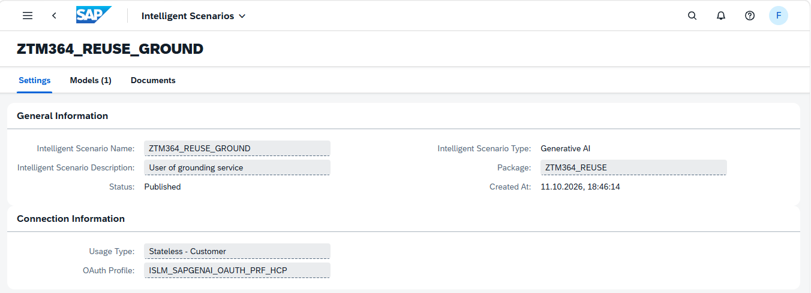
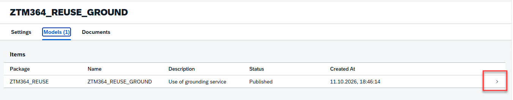
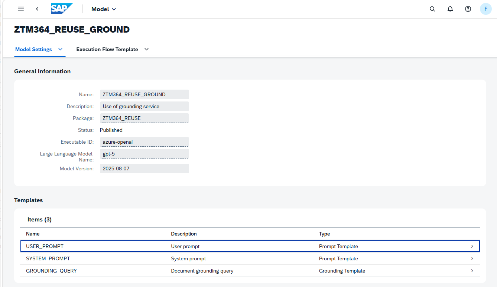
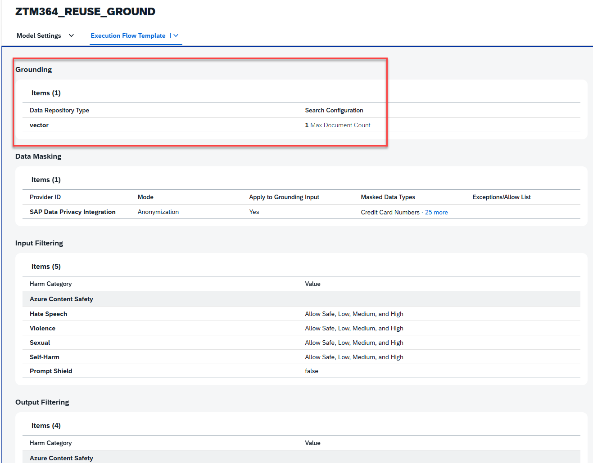
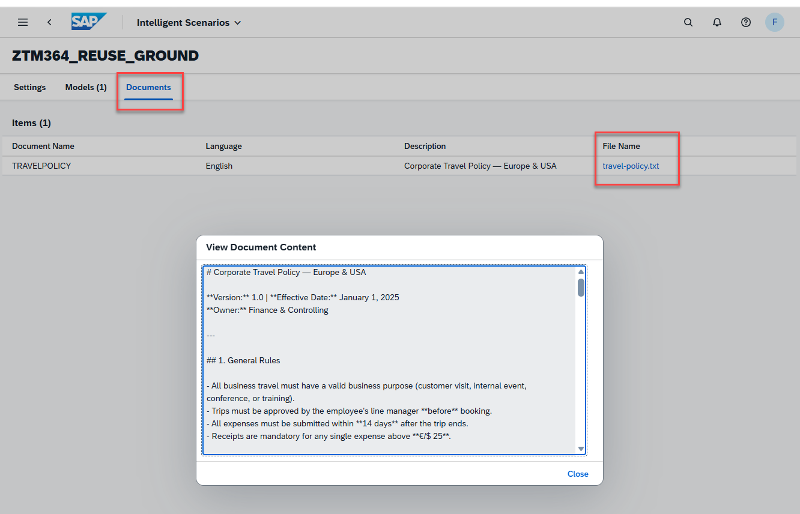

[Home - TM364](../../#exercises)

# Exercise 7: Make Use of Grounding Capabilities by Using a Travel Policy Document

In this exercise, you will develop a class that uses a preconfigured ISLM scenario with an uploaded travel policy as a grounding document.

The data will be retrieved from a trip that you have created using your _Trip App_.

Using the ABAP AI SDK, it will be checked whether the expenses on that trip are compliant with a travel policy that has been uploaded as a grounding document to an ISLM scenario.

```
    METHODS check_trip_compliance IMPORTING i_trip_category     TYPE char02
                                            i_trip_details      TYPE string OPTIONAL
                                            i_trip_expenses     TYPE string
                                            i_islm_scenario     TYPE aic_islm_scenario_id=>type
                                            i_show_grounding    TYPE abap_bool DEFAULT abap_false
                                  EXPORTING e_response          TYPE string
                                            e_compliance_status TYPE char1.
```

The class offers a method `check_trip_compliance()` that has five input parameters:  
- **i_trip_category** to provide the two character trip category
- **i_trip_details** to provide the trip details
- **i_trip_expenses** to provide the expenses (we will use a JSON string created from the expenses table)
- **i_islm_scenario** to try out different _ISLM scenarios_ of type GENAI
- **i_show_grounding** is an optional parameter to add the content of the grounding document to the response
The method returns two parameters: 
- **e_response** contains a summary provided by the LLM 
- **e_compliance_status** contains a single character compliance category. The _name_ of the category can be retrieved via the view entity [ZTM364_I_COMPLIANCE_STATUS](adt://S4H/sap/bc/adt/ddic/ddl/sources/ZTM364_I_COMPLIANCE_STATUS?version=active). 

In exercise 8, we will then re-use this class in the implementation of an action of the RAP business object for trip management. 

This way, the code of the behavior implementation class would be refactored and at the same time it is easier to generate appropriate unit tests.

To be able to try out the effect of using different ISLM scenarios, this RAP BO will offer a value help to select one ISLM scenario of your choice for each single trip. 

# Exercises

- [7.1 - Check the pre-configured ISLM Scenario](#exercise-71-check-the-pre-configured-islm-scenario)
- [7.2 - Create a class to use an ISLM scenario with grounding using the ABAP AI SDK](#exercise-72-create-a-class-to-use-an-islm-scenario-with-grounding-using-the-abap-ai-sdk)
- [7.3 - Test the class](#exercise-73-test-the-class)
- [Summary & Next Exercise](#summary--next-exercise)

> ℹ️ **Reminder**: Don't forget to replace all occurrences of the placeholder **`###`** with your group ID in the exercise steps below.

## Exercise 7.1: Check the Pre-Configured ISLM Scenario

Using the built in Fiori App **Intelligent Scenarios**, you can have look at the details of Intelligent Scenarios that do exist in your system. The application shows both, ISLM scenarios that have been delivered by SAP and ISLM scenarios that have been built by customers. We will start by investigating the custom ISLM scenario that supports grounding capabilities.  

<details>
  <summary>🔵 Click to expand!</summary>

1. Open the following link **in a new window** to the [Intelligent Scenarios App](https://s4hana.tdc.sap.com:50081/sap/bc/ui2/flp?sap-client=400&sap-language=EN#IntelligentScenario-register&/SIDEBYSIDE/ZTM364_REUSE_GROUND). 

   

2. You have to authenticate using your user name `TM364-###` and password `<provided by the instructors>`.  

3. Check out the **Settings** of the ISLM scenario `ZTM364_REUSE_GROUND` which is of type **Generative AI**.  


   


4. Navigate to the **Models** tab and click on the **>** to open the model details.

   

5. The **Model settings** will be opened, which shows that our model contains a user prompt template and a **grounding query template**.      

   

6. Navigate to the **Execution Flow Template** tab, where we can see the grounding settings.

   

7. Finally, check the documents section where we can check the travel policy document. 

   

</details>


## Exercise 7.2: Create a Class to Use an ISLM Scenario with Grounding Using the ABAP AI SDK
[^Top of page](#)

> In this exercise you will create a class  `ztm364_cl_islm_trip_compl_###` to call a Large Language Model via the ABAP AI SDK that supports grounding. The source code has been provided for your convenience in the following section.

1. Right-click on your package  **`ZTM364_###`** and select **New** > **ABAP Class**.

2. Enter the following values:

   | Field | Value |
   |---|---|
   | Name | **`ztm364_cl_islm_trip_compl_###`** |
   | Description | **`Check trip compliance via ISLM with grounding`** |

3. Replace the complete class definition with the 📄source code provided below,   
   and replace all occurrences of the placeholder **`###`** with your personal suffix using **Ctrl+F**.

4. Save  (**Ctrl+S**) and activate  (**Ctrl+F3**) the changes.

 >💡**Hints**:  
      - Replace all occurrences of the placeholder **`###`** with your personal suffix using _**Find and Replace All**_ function (**Ctrl+F**)  
      - Use the **ABAP Formatter** function (**Ctrl+F1**) to format your source code  
        (You may need to configure the _ABAP Formatter_ and the _DDL Formatter_ if using it for the first time in a given system under the Eclipse menu **Window > Preferences** and navigate to **ABAP Development > Source Code Editor** to configure the _**ABAP Formatter**_.)
    

<details>
     <summary>🟡📄 Click to expand the source code!</summary>

          
  
   ```abap   
 
  
CLASS ztm364_cl_islm_trip_compl_### DEFINITION
PUBLIC
FINAL
CREATE PUBLIC .

  PUBLIC SECTION.

    INTERFACES if_oo_adt_classrun .


    METHODS check_trip_compliance IMPORTING i_trip_category     TYPE char02
                                            i_trip_details      TYPE string OPTIONAL
                                            i_trip_status       TYPE char1 OPTIONAL
                                            i_trip_expenses     TYPE string
                                            i_islm_scenario     TYPE aic_islm_scenario_id=>type
                                            i_show_grounding    TYPE abap_bool DEFAULT abap_false
                                  EXPORTING e_response          TYPE string
                                            e_compliance_status TYPE char1.

  PROTECTED SECTION.
  PRIVATE SECTION.

    TYPES: BEGIN OF ty_compliance_state,
             compliancestatus TYPE c LENGTH 2,
             description      TYPE string,
           END OF ty_compliance_state,
           ty_compliance_statuses TYPE STANDARD TABLE OF ty_compliance_state WITH EMPTY KEY.

ENDCLASS.


CLASS ztm364_cl_islm_trip_compl_### IMPLEMENTATION.
  METHOD if_oo_adt_classrun~main.
    DATA response_text TYPE string.
    DATA ints          TYPE aic_islm_scenario_id=>type VALUE 'ZTM364_REUSE_GROUND3'.

    SELECT SINGLE FROM zr_trip###
      FIELDS *
      WHERE tripid = '102'
      INTO @DATA(trip).

    SELECT expense_description,
           category,
           transaction_type,
           receipt_date,
           amount,
           currency
      FROM zexpense###
      WHERE parent_uuid = @trip-uuid
      INTO TABLE @DATA(expenses).

    " Serialize to JSON
    DATA(lv_json) = /ui2/cl_json=>serialize( data        = expenses
                                             compress    = abap_true
                                             pretty_name = /ui2/cl_json=>pretty_mode-camel_case ).

    out->write( lv_json ).

    check_trip_compliance( EXPORTING i_trip_category     = trip-Type
                                     i_trip_details      = trip-Details
                                     i_trip_status       = trip-Status
                                     i_trip_expenses     = lv_json
                                     i_islm_scenario     = ints
                                     i_show_grounding    = abap_false
                           IMPORTING e_response          = response_text
                                     e_compliance_status = DATA(status) ).

    out->write( |Compliance status: { status }|  ).
    out->write( |response: { response_text }|  ).
  ENDMETHOD.

  METHOD check_trip_compliance.
    " TODO: parameter I_TRIP_DETAILS is never used (ABAP cleaner)

    TYPES: BEGIN OF t_compliance_type,
             compliance_status TYPE char1,
             summary           TYPE string,
           END OF t_compliance_type.

    DATA result_trip_compliance TYPE t_compliance_type.

    DATA compliance_statuses    TYPE ty_compliance_statuses.
    DATA error_text             TYPE string.
    DATA grounding_output       TYPE string.

    SELECT SINGLE description FROM ZTM364_I_Trip_Type
      WHERE Type = @i_trip_category
      INTO @DATA(trip_type_description).

    SELECT ComplianceStatus, Description
      FROM ztm364_i_compliance_status
      INTO CORRESPONDING FIELDS OF TABLE @compliance_statuses.

    DATA(prompt_string) = |This is a trip of trip category \r\n{ trip_type_description } ({ i_trip_category }).|.
    IF i_trip_status = 'P'.
      prompt_string = |{ prompt_string }The trip has been approved by a manager since it status is set to { i_trip_status }r\n|.
    ENDIF.
    prompt_string = |{ prompt_string }List of expenses:\r\n|.
    prompt_string = |{ prompt_string }{ i_trip_expenses }\r\n|.
    prompt_string = |{ prompt_string }Please check if all expenses fit to the travel policy.| &&
    |The following trip statuses exist: { cl_abap_char_utilities=>cr_lf }|.

    LOOP AT compliance_statuses INTO DATA(compliance_status).
      prompt_string = |{ prompt_string }{ compliance_status-ComplianceStatus } ({ compliance_status-Description }) |.
    ENDLOOP.

    prompt_string = |{ prompt_string }Please check if all expenses fit to the travel policy.|.

    prompt_string = |{ prompt_string }You must accept higher rates for cities that are listed as "High-cost cities" in the grounding document.|.

    prompt_string = |{ prompt_string }Do NOT wrap the response in markdown. Respond in valid JSON.{ cl_abap_char_utilities=>cr_lf }|
                     && |\{ { cl_abap_char_utilities=>cr_lf }|
                     && |"Summary" :"",{ cl_abap_char_utilities=>cr_lf }|
                     && |"Compliance_Status" :"",{ cl_abap_char_utilities=>cr_lf }|
                     && |\}{ cl_abap_char_utilities=>cr_lf }|.

    prompt_string = |{ prompt_string }the statusfield can have the following values: \r\n|.
    LOOP AT compliance_statuses INTO compliance_status.
      prompt_string = |{ prompt_string }{ compliance_status-ComplianceStatus } ({ compliance_status-Description }) { cl_abap_char_utilities=>cr_lf }|.
    ENDLOOP.

    TRY.

        DATA(api) = cl_aic_islm_orch_api_factory=>get( )->create_instance( islm_scenario = i_islm_scenario ).

        api->configure_templating( )->add_prompt_template( template_id  = 'SYSTEM_PROMPT'
                                                           message_type = aic_prompt_message_type=>user_message ).

        api->configure_templating( )->add_user_message( message = prompt_string ).

        api->configure_grounding( )->add_grounding_template( template_id = 'GROUNDING_QUERY' ).

        " For demo purpose only: check the grounding module's output, i.e. check
        " which document has been retrieved by the grounding query
        IF i_show_grounding = abap_true.
          grounding_output = api->execute( )->grounding_result( )->output( ).
        ENDIF.

        FINAL(response) = api->execute( )->orchestration_result( )->completion( ).

        /ui2/cl_json=>deserialize( EXPORTING json        = response
                                             pretty_name = /ui2/cl_json=>pretty_mode-camel_case
                                   CHANGING  data        = result_trip_compliance ).

        e_response = result_trip_compliance-summary.
        IF i_show_grounding = abap_true.
          e_response = |{ e_response }\r\n Grounding:\r\n{ grounding_output }|.
        ENDIF.
        e_compliance_status = result_trip_compliance-compliance_status.

      CATCH cx_aic_api_factory
            cx_aic_prompt_template
            cx_aic_completion_api INTO DATA(lx_previous2).
        error_text = lx_previous2->get_text( ).
        e_compliance_status = 'E'.
        e_response = error_text.
      CATCH cx_root INTO DATA(my_exception).
        error_text = my_exception->get_text( ).
        e_compliance_status = 'E'.
        e_response = error_text.
    ENDTRY.
  ENDMETHOD.

  ENDCLASS.


 
    
   ```
  </details>
     


## Exercise 7.3: Test the Class

1. Check the content of the `main()` method of your class. 

   In the `main()` method the details of a trip are being determined via the following select statement.

   ```
      SELECT SINGLE FROM zr_trip###
      FIELDS *
      WHERE tripid = '55'
      INTO @DATA(trip).

   ```   

   So you have to retrieve a valid value for **TripId** from your RAP BO which contains expenses.

2. Retrieve an existing **TripID** from your Fiori Elements Application and enter it in line 34 in the main method.
3. Save  (**Ctrl+S**) and activate  (**Ctrl+F3**) the changes.      
   
   <!-- For this run your CDS base view entity **`zr_trip###`** by putting the cursor in the source code on it and pressing **F8**. This opens the data preview. Copy the UUID of the instance you want to use into the class and save  (**Ctrl+S**) and activate  (**Ctrl+F3**) the change.
   -->

4. Execute the class as **Console App** by pressing **F9**.

     You should receive a response like the following:

       
## JSON - Expenses

```
[
    {
        "expenseDescription": "Sheraton Bratislava Hotel - Accommodation; Invoice 451418; Stay 17-20 Nov 2025",
        "category": "HT",
        "transactionType": "CC",
        "receiptDate": "2025-11-20",
        "amount": 495.00,
        "currency": "EUR"
    }
]
```

## Compliance Status - Result

Compliance status: m

response: Training trips require Manager + HR pre-approval; no approval info provided. Hotel: 3 nights (17–20 Nov 2025) at €165/night (total €495). Rate is within Standard (€180) and High-cost (€250) caps, but exceeds the 'All other cities' cap (€160) by €5/night—city category not specified. Receipt referenced (Invoice 451418). Corporate booking tool usage not indicated.


## Summary & Next Exercise
[^Top of page](#)

Now that you've...
- created a class that can be used as API for trip compliance checking

... you can continue with the next exercise – **[Exercise 8: Add an action to check whether your trip is compliant](../ex08/README.md)**

---

