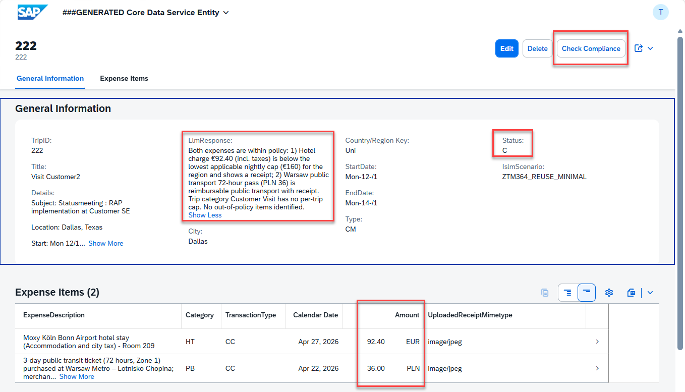
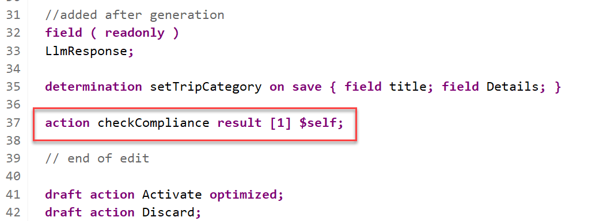
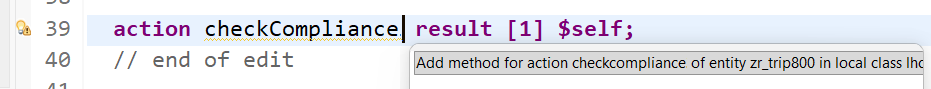
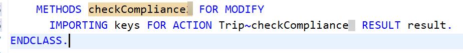
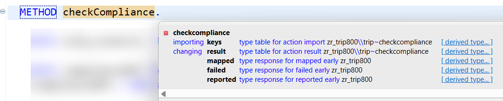
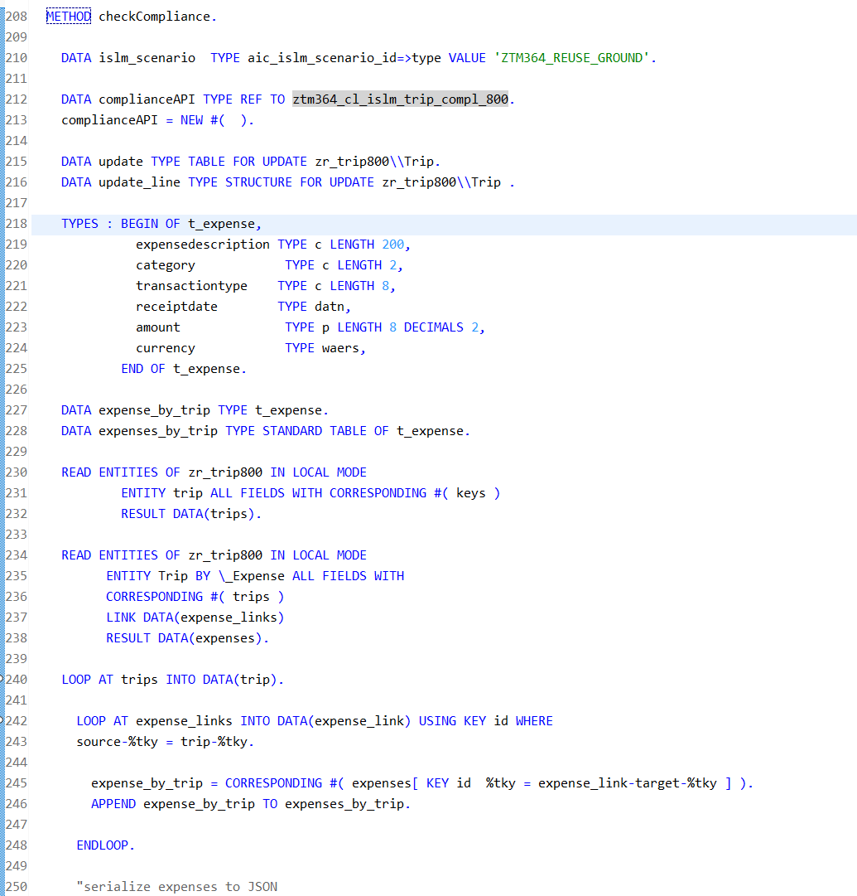
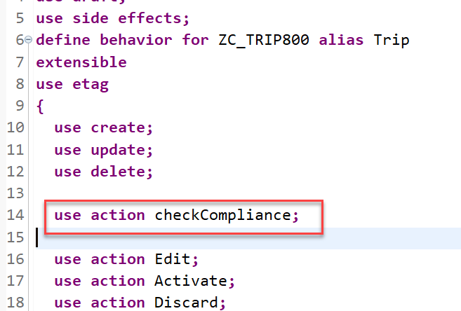

[Home - TM364](../../#exercises)

# Exercise 8: Add an Action to Check Whether Your Trip Is Compliant

In this exercise, you will use the class that has been created in the previous **[Exercise 7](../ex07/README.md)** to implement an action in your Fiori elements application that allows the user to check whether a trip complies with the travel policy or not. 

The result of the check will update the `Status` field and the full response of the LLM will be stored in the multi-line field `LlmResponse`. 



## Exercise 8.1: Add the Instance-Bound Action - checkCompliance

> Start with defining the action `checkCompliance` in the base behavior definition **`ZR_TRIP###`**.

<details>
  <summary>🔵 Click to expand!</summary>

1. Go to your behavior definition **`ZR_TRIP###`** and define the instance action without input parameter.
   
   For that, insert the following code snippet after the defined determination as shown on the screenshot below.
   
   ```
     action checkCompliance result [1] $self;
   ```      
   
   The result should look like this:   
  
   
   
   **Short explanation**:  
   - The name of the instance action is specified after the keyword **`action`**
   - The keyword **`result`** defines the output parameter of the action.
      - Its cardinality is specified between the square brackets (`[cardinality]`). It is a mandatory addition.  
      - **`$self`** specifies that the type of the result parameter is the same type as the entity for which the action or function is defined - i.e. the _Trip_ entity type in the present exercise. The return type of the result parameter can be an entity or a structure.     
    - **Note**: The output parameter **`result`** can be used to store the result of an action or function in an internal table. However, it does not affect the result of an action or function that is committed to the database.   
      
    > ℹ **Further reading**: [Action Definition](https://help.sap.com/docs/abap-cloud/abap-rap/action-definition?locale=en-US) 

2. Save  and activate  the changes.

3. Now, declare the required method in behavior implementation class with the ADT Quick Fix.

   Set the cursor on the action name, **`checkCompliance`**, and press **Ctrl+1** to open the **Quick Assist** view.
  
    Double-click on the entry _**`Add method for action checkCompliance of entity zr_trip### ...`**_ to add the required method to the local handler class.   

    
     
      
4. Save  the change in the local handler class.

5. Set the cursor on the method name, **`checkCompliance`**, press **F3** to navigate to the declaration part of the local handler class of the behavior pool **`ZBP_R_TRIP###`**.   

  
      
   
6. In the declaration part, set the cursor on the method name, **`checkCompliance`**, press **F2**, and examine the full method interface.   
      
      
  
   **Short explanation**:  
   - The addition **`FOR MODIFY`** after the method name, together with the addition **`FOR ACTION`** after the importing parameter, indicates that this method provides the implementation of an action.
   - Method signature for the non-factory instance action `checkCompliance`:
     - `IMPORTING` parameter **`keys`** - a table containing the keys of the instances on which the action must be executed
     - Implicit `CHANGING` parameters (aka _implicit response parameters_):  
       - **`result`** - used to store the result of the performed action.
       - **`mapped`** - table providing the consumer with ID mapping information.
       - **`failed`** - table with information for identifying the data set where an error occurred.
       - **`reported`** - table with data for instance-specific messages.
      
    > 
  
    > **Please note**:  
    > An action is implemented in a **`FOR MODIFY`** method with the addition **`FOR ACTION`**. The signature of an action method always depends on the type of action: factory or non-factory, and instance or static.   
    > The rules for implementing an action operation in a RAP business object are explained in the respective _**Implementation Contract**_.      
    
    > ℹ **Further reading**: [Action Implementation](https://help.sap.com/docs/abap-cloud/abap-rap/action-implementation?locale=en-US&ai=true)  **|**  [Implementation Contract: Action](https://help.sap.com/docs/abap-cloud/abap-rap/implementation-contract-action?locale=en-US)   
   
    Proceed with the implementation of the action method.     

</details>

### Exercise 8.1.2: Implement the Action Method

> Now implement the action behavior in the appropriate method in the behavior pool of the _Trip_ entity.

<details>
  <summary>🔵 Click to expand!</summary>
  
1. Implement the action method **`checkCompliance`**.

   The main steps of the implemented business logic: 
   1. Read the data for the trips and the expenses for each trip.    
   2. Loop over all trips and for each trip select the expenses, fill an internal table with the data and generate a JSON string so that the data can be sent to the LLM
   3. Use the class `ztm364_cl_islm_trip_compl_###` that has been created in the exercise before and use the method `check_trip_compliance` to check whether the expenses of your trip do comply with the Travel Policy.   
   4. Use the result to update the `Status` field and the `LlmResponse` field
   5. Modify the relevant fields of the instances with the EML statement **`MODIFY`**: Here only the fields **`LlmResponse`** and **`Status`** must be updated.   
   6. Read the data from the buffer with the EML statement **`READ`** to fill the action result parameter **`result`**.  
   7. The implicit response parameters are filled where necessary:
      - **`failed`** - with information for identifying the data set where an error occurred.
      - **`mapped`** - table providing the consumer with ID mapping information.
      - **`reported`** - with data for instance-specific messages in case of failure.

   Replace the current method implementation with the code snippet provided below and replace all occurrences of the placeholder **`###`** with your group ID. 
   
   You can use the **ABAP Pretty Printer** (**Shift+F1**) to format your source code.


   <pre lang="ABAP">  
   **************************************************************************
   * Instance-bound non-factory action:
   * Check compliance of trip expenses
   **************************************************************************
   METHOD checkCompliance.
   
    DATA islm_scenario  TYPE aic_islm_scenario_id=>type VALUE 'ZTM364_REUSE_GROUND3'.

    DATA complianceAPI TYPE REF TO ztm364_cl_islm_trip_compl_###.
    complianceAPI = NEW #(  ).

    DATA update TYPE TABLE FOR UPDATE zr_trip###\\Trip.
    DATA update_line TYPE STRUCTURE FOR UPDATE zr_trip###\\Trip .

    TYPES : BEGIN OF t_expense,
              expensedescription TYPE c LENGTH 200,
              category            TYPE c LENGTH 2,
              transactiontype    TYPE c LENGTH 8,
              receiptdate        TYPE datn,
              amount              TYPE p LENGTH 8 DECIMALS 2,
              currency            TYPE waers,
            END OF t_expense.

    DATA expense_by_trip TYPE t_expense.
    DATA expenses_by_trip TYPE STANDARD TABLE OF t_expense.

    READ ENTITIES OF zr_trip### IN LOCAL MODE
            ENTITY Trip ALL FIELDS WITH CORRESPONDING #( keys )
            RESULT DATA(trips).

    READ ENTITIES OF zr_trip### IN LOCAL MODE
          ENTITY Trip BY \_Expense ALL FIELDS WITH
          CORRESPONDING #( trips )
          LINK DATA(expense_links)
          RESULT DATA(expenses).

    LOOP AT trips INTO DATA(trip).

      LOOP AT expense_links INTO DATA(expense_link) USING KEY id WHERE
      source-%tky = trip-%tky.

        expense_by_trip = CORRESPONDING #( expenses[ KEY id  %tky = expense_link-target-%tky ] ).
        APPEND expense_by_trip TO expenses_by_trip.

      ENDLOOP.

      "serialize expenses to JSON
      DATA(expenses_as_json) = /ui2/cl_json=>serialize( data     = expenses_by_trip
                                               compress    = abap_true
                                               pretty_name = /ui2/cl_json=>pretty_mode-camel_case ).

      complianceAPI->check_trip_compliance(
        EXPORTING
          i_trip_category     = trip-Type
          i_trip_details      = trip-Details
          i_trip_expenses     = expenses_as_json
          i_islm_scenario     = islm_scenario
         "i_show_grounding    = abap_false
        IMPORTING
          e_response          = update_line-LlmResponse
          e_compliance_status = update_line-status
      ).

      update_line-%tky = trip-%tky.

      APPEND update_line TO update.

    ENDLOOP.

    MODIFY ENTITIES OF zr_trip### IN LOCAL MODE
      ENTITY Trip
      UPDATE FIELDS (  LlmResponse status )
      WITH  update
      REPORTED DATA(update_reported) .

    " read changed data for action result
    READ ENTITIES OF zr_trip### IN LOCAL MODE
        ENTITY Trip
        ALL FIELDS WITH
        CORRESPONDING #( trips )
        RESULT DATA(trips_with_compliance_check).

    "Set the changing parameter
    reported = CORRESPONDING #( DEEP update_reported ).

    " set action result
    result = VALUE #( FOR trip_compl IN trips_with_compliance_check ( %tky   = trip_compl-%tky
                                                              %param = trip_compl ) ).

    

   ENDMETHOD.
   </pre>

   The result should look like this:

   <!--  -->
        

   **Short explanation**:  
   - The provided implementation is mass-enabled. This is recommended. 
   - The EML statement **`MODIFY ENTITIES ... UPDATE FIELDS`** is used to update specific fields of the instances.     
   - The internal tables are filled inline using the constructor operator **`VALUE`** which made the need for explicit declaration obsolete.       
   - The EML statement **`READ ENTITIES ... ALL FIELDS WITH CORRESPONDING`** is used to read all fields of the updated instances from the buffer to fill the input parameter `result`.        

2. Save  and activate  the changes.     

</details>

### Exercise 8.1.3: Expose and Test the Action

> In contrary to determinations and validations which are automatically called by the RAP runtime at the specified trigger time, actions must be explicitly exposed on the BO projection layer and called by a consumer, e.g. on the UI or directly via EML statements. 
>  
> Now, you will expose the action in the BO behavior projection and enrich the UI semantics in the CDS metadata extension to add an appropriate button to the _Trip App_.

 <details>
  <summary>🔵 Click to expand!</summary>

1. Expose the action in the BO behavior projection.
   
   Go to your behavior projection **`ZC_TRIP###`** and insert the following code snippet as shown on the screenshot below. 
   
   The keyword **`use action`** indicates that a behavior of the base BO is used on the projection layer.
   
   ```
   use action checkCompliance;
   ```
   
   The result should look like this:

   
      
2. Save  and activate  the changes.  

3. Enhance UI semantics to make the action **`checkCompliance`** only visible on the object page with the label _**Check Compliance**_. 

   For that, open your metadata extension **`ZC_TRIP###`** and replace the existing **`@UI`** annotation block placed before the element **`Title`** with the code snippet provided below as shown on the screenshot below. The semantics of the annotation **`@UI.identification`** will be enhanced for the purpose. 
   

      
   <pre lang="ABAP CDS">
      @EndUserText.label: 'Title'
      @UI.identification: [ {
        position: 30 ,
        label: 'Title'
        } 
        ,{ type: #FOR_ACTION, dataAction: 'checkCompliance', label: 'Check Compliance' }
        ]
      @UI.lineItem: [ {
        position: 30 ,
        label: 'Title'
       } ]
     Title;
   </pre>

4. Save  and activate  the changes.

5. Refresh the application. The result should look like this:
   
   <!--  -->
        

</details>

## Preview and test the enhanced Fiori elements App.

For your convienience we have provided some sample data for _hotel receipts_, _taxi receipts_ and and email to provide the trip details and expenses. The naming e.g. **EU10** indicates data sets for one trip.

The receipts and the email texts can be [downloaded from here](../../receipts/) (Tip: open in a new tab or browser window).


| Sample Data | Expected Compliance Status | Reason | Notes |
|---|---|---|---|
| EU02 | C (Compliant) | Accommodation and transportation costs are within the limits (high cost city). | — |
| EU01 | M (Manager approval required) | Berlin (standard city): Hotel costs exceed the limit and require justification. | Edit the trip and change its status to "P" to indicate manager pre-approval. |
| US08 | M (Manager approval required) | Atlanta (standard city): Taxi costs exceed the limit and require justification. | Edit the trip and change its status to "P" to indicate manager pre-approval. |
| US10 | N (Non-compliant) | Minibar expenses are non-reimbursable. | Manager pre-approval does not change the compliance status from "N". |ge status "N" |


1. Create a new _Trip_ entry.
2. Use the email for one of the provided sample scenarios (EU01, EU02, ...) and let ISLM fill the trip details.
3. Upload both receipts for _Taxi_ and _Hotel_ for that scenario.   
4. Navigate to the object page, and click on the new action button _**Check Compliance**_. 
   
Check the action result: the value of the field `Status` should have changed and the response should have been saved into the field `LlmResponse` as shown above. 

The LLM will probably complain that it can't check whether a pre-approval of the trip does exist (as requested by the travel policy). You can add this pre-approval information by settting the status to **`P`**, **pre-approved-by-manager**.
        
If you wish, you can also define the button on the list report page in the CDS metadata extension, activate the changes, and re-test the app.

## Summary & Next Exercise
[^Top of page](#)

Now that you've...
- created and implemented an action to check the trip compliance

You are now done.

**Congratulations** 

If you want to build your own ISLM scenario, please check out the section **[Further Information](../../#further-information)** on the intro page of this hands-on session.   

[Home - TM364](../../#exercises)

